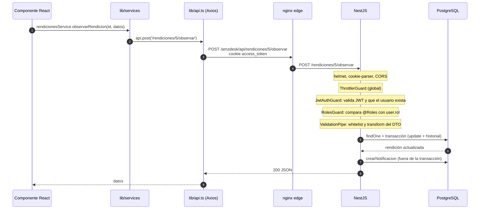

# Ciclo de una petición

Qué pasa entre que un componente del frontend llama a un servicio y la respuesta vuelve. El
ejemplo es la observación de una rendición (`POST /rendiciones/:id/observar`).

## Paso a paso

1. **Servicio del frontend.** La regla es que los componentes llamen a un objeto de
   `lib/services/*-service.ts`, que a su vez usa la instancia `api` de `lib/api.ts`. Hay
   excepciones que llaman a `api` directamente (por ejemplo `app/app/aprobaciones/inbox-actions.tsx`
   para derivar y observar solicitudes).
2. **Axios.** `api` tiene `baseURL = NEXT_PUBLIC_API_URL` (`/amzdesk/api` en producción, horneado
   en el build) y `withCredentials: true`, así que el navegador adjunta la cookie httpOnly
   `access_token`. El frontend no lee ni guarda el token.
3. **nginx.** Recorta `/amzdesk/api` y reenvía al contenedor del backend.
4. **Middlewares de Express** registrados en `src/main.ts`: `helmet` (sin CSP), `cookie-parser` y
   CORS limitado a `FRONTEND_URL` con credenciales.
5. **Guards.** Primero el `ThrottlerGuard` global (`APP_GUARD` en `app.module.ts`). Luego, si el
   controlador lo declara, `JwtAuthGuard` (estrategia `jwt`) y `RolesGuard`. Ver
   [Autenticación y autorización](../backend/autenticacion.md).
6. **Pipe global.** `ValidationPipe` con `whitelist`, `forbidNonWhitelisted` y `transform`: un
   campo que no está en el DTO devuelve 400.
7. **Controlador → servicio.** El controlador solo extrae parámetros y el usuario de `req.user`;
   la lógica vive en el servicio. Las escrituras de varias tablas van en
   `this.prisma.$transaction(...)`.
8. **Efectos laterales.** Las notificaciones se crean **después** de la transacción, dentro de un
   `try/catch` que solo registra el error: una notificación fallida no revierte la operación.
9. **Errores.** Cualquier excepción pasa por los filtros globales
   (`PrismaClientExceptionFilter` y `AllExceptionsFilter`). Ver
   [Validación y errores](../backend/validacion-y-errores.md).
10. **Vuelta al frontend.** Si la respuesta es 401, el interceptor de `lib/api.ts` limpia la sesión
    y emite `auth-expired`; un 429 recibe un mensaje en español; un error de red se reescribe
    para el usuario. El componente muestra el error con `toast.error`.

## Descargas de PDF y vistas de documento

Siguen el mismo camino, con dos diferencias:

- `GET .../pdf` responde `application/pdf` y el frontend lo pide como `Blob`
  (`lib/utils/download-blob.ts` comprueba el `Content-Type` antes de descargar).
- `GET .../documento` (o `.../anexo1`, `.../anexo2`, `.../anexo4`) responde `text/html` y el
  frontend lo pinta en un `iframe` aislado. Ver
  [Documentos en pantalla](../frontend/documentos-en-pantalla.md).

Los endpoints de PDF llevan `@SkipThrottle()`: generar un documento no consume cupo de rate
limiting.
