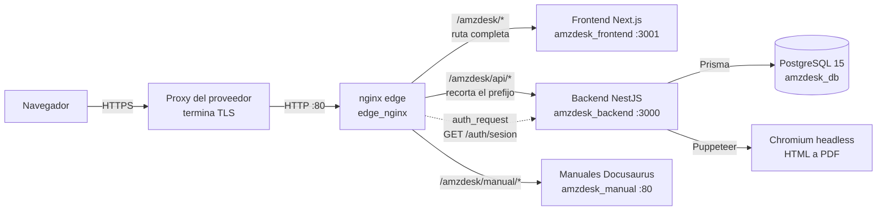

# Visión general

AMZ Desk son **dos aplicaciones y una base de datos** detrás de un proxy:

- **Frontend**: Next.js 16 (App Router), repo `Conservacion-amazonica-frontend`, puerto `3001`.
- **Backend**: API REST en NestJS 11 con Prisma 5, repo `Conservacion-amazonica-backend`, puerto `3000`.
- **Base de datos**: PostgreSQL 15.
- **Manuales**: este sitio y el de usuario, compilados con Docusaurus y servidos por un nginx
  estático propio.

En producción todo cuelga del prefijo `/amzdesk` de un dominio compartido con otros sistemas.

## Diagrama



El navegador **nunca habla con el backend por otro origen**: la API se publica bajo el mismo
dominio, en `/amzdesk/api`, y el frontend la llama con una URL relativa.

## Quién atiende cada ruta

La tabla sale de `deploy/edge/nginx.conf` del repo del backend.

| Ruta pública               | Destino                | Qué hace nginx                                                                               |
| -------------------------- | ---------------------- | -------------------------------------------------------------------------------------------- |
| `/amzdesk/api/doc`         | backend                | Solo `127.0.0.1` y las IP que se agreguen con `allow`. Swagger queda cerrado a internet      |
| `/amzdesk/api/`            | backend `:3000`        | `rewrite` quita `/amzdesk/api`: Nest no usa `setGlobalPrefix`. Timeouts de 120 s por los PDF |
| `/amzdesk/manual/tecnico/` | contenedor de manuales | `auth_request` contra `GET /auth/sesion`; sin sesión, 302 a `/amzdesk/login`                 |
| `/amzdesk/manual/`         | contenedor de manuales | Público                                                                                      |
| `/amzdesk`                 | frontend `:3001`       | Reenvía la ruta **completa**: Next se compila con `basePath=/amzdesk`                        |

```nginx title="deploy/edge/nginx.conf (extracto)"
location /amzdesk/api/ {
    set $amzdesk_api http://amzdesk_backend:3000;
    rewrite ^/amzdesk/api/(.*)$ /$1 break;
    proxy_pass $amzdesk_api;
    proxy_read_timeout 120s;
}
```

:::info
`resolver 127.0.0.11` y los destinos en variables (`set $amzdesk_api ...`) existen porque cada
despliegue recrea los contenedores con otra IP. Sin eso nginx guardaría la IP vieja y
respondería 502.
:::

## Contenedores

`deploy/docker-compose.prod.yml` define el stack `amzdesk`:

| Servicio   | Contenedor         | Redes             | Notas                                                                 |
| ---------- | ------------------ | ----------------- | --------------------------------------------------------------------- |
| `db`       | `amzdesk_db`       | `interna`         | `postgres:15-alpine`. No está en la red `edge`: solo lo ve el backend |
| `backend`  | `amzdesk_backend`  | `interna`, `edge` | `shm_size: 512m` para Chromium                                        |
| `frontend` | `amzdesk_frontend` | `edge`            | Imagen `standalone` de Next                                           |
| `manual`   | `amzdesk_manual`   | `edge`            | nginx estático, `mem_limit: 64m`                                      |

Ningún servicio publica puertos. El único que escucha en el host es `edge_nginx`, que vive en
otro stack (`deploy/edge/docker-compose.yml`) para que desplegar AMZ Desk no reinicie el proxy
de los demás sistemas del dominio.

## Generación de PDF

Los documentos (anexos) se generan **en el backend**: una plantilla Handlebars produce HTML y
Puppeteer lo imprime con un Chromium del sistema (`PUPPETEER_EXECUTABLE_PATH=/usr/bin/chromium`
en la imagen). Se lanza **un navegador por cada PDF** y se cierra al terminar. El detalle está en
[Generación de documentos](../documentos/generacion.md).

## Siguiente lectura

El detalle operativo del proxy y de los contenedores está en
[Proxy edge](../despliegue/proxy-edge.md) y [Stack de producción](../despliegue/stack-produccion.md).

- [Stack y versiones](./stack.md)
- [Ciclo de una petición](./ciclo-de-una-peticion.md)
- [Decisiones de diseño](./decisiones.md)
