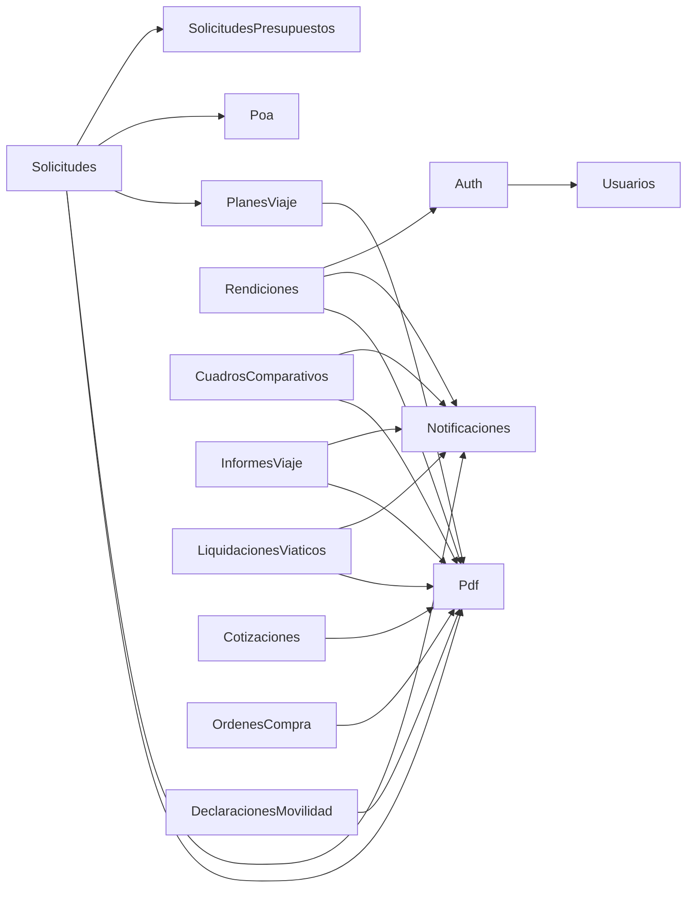

# Módulos

El backend tiene **26 módulos NestJS** (archivos `*.module.ts` bajo `src/`, sin contar
`app.module.ts`): 18 de primer nivel y 8 catálogos bajo `src/catalogos/`. Todos se registran en
`src/app.module.ts`.

:::info
`CLAUDE.md` habla de 24 módulos y `specs/000-baseline.md` de 25. Los dos se quedaron atrás:
faltan `planes-viaje` y `liquidaciones-viaticos` en el primero, y `liquidaciones-viaticos` en el
segundo. Este conteo sale de los archivos.
:::

## Mapa de dependencias

Solo las importaciones entre módulos de dominio. `PrismaModule` se omite porque es global.



## Módulos de dominio

| Módulo                     | Ruta base                  | Qué posee                                                                                                                | Archivos clave                                                                                     |
| -------------------------- | -------------------------- | ------------------------------------------------------------------------------------------------------------------------ | -------------------------------------------------------------------------------------------------- |
| `auth`                     | `/auth`                    | Login, logout, comprobación de sesión, estrategia JWT, guards y decoradores                                              | `auth.controller.ts`, `jwt.strategy.ts`, `auth-cookie.util.ts`, `guards/`, `decorators/`           |
| `usuarios`                 | `/usuarios`                | Alta, edición y baja lógica de usuarios (solo `ADMIN`); listado `lookup/activos` para los selectores                     | `usuarios.service.ts`                                                                              |
| `poa`                      | `/poa`                     | Líneas del POA, saldo disponible calculado al vuelo y búsquedas por proyecto, grupo y partida                            | `poa.service.ts`                                                                                   |
| `solicitudes`              | `/solicitudes`             | La solicitud de fondos (viaje o compra), su máquina de estados, cuotas de consultoría (`PagoParcial`), ANEXO 2 y ANEXO 3 | `solicitudes.service.ts`, `solicitudes.helper.ts`, `anexo2.builder.ts`, `solicitudes.constants.ts` |
| `solicitudes-presupuestos` | sin controlador            | Recalcula los subtotales de `SolicitudPresupuesto` por POA                                                               | `solicitudes-presupuestos.service.ts` (`recalcularTotales`)                                        |
| `planes-viaje`             | `/planes-viaje`            | Plan de Viaje (ANEXO 1) y sus filas `Planificacion`; entrega el plan a la solicitud                                      | `planes-viaje.service.ts`, `planes-viaje.helper.ts`, `anexo1.builder.ts`                           |
| `rendiciones`              | `/rendiciones`             | Rendición (ANEXO 4) en PDF, HTML y Excel; aprobación que ejecuta el POA                                                  | `rendiciones.service.ts`, `rendiciones.helper.ts`, `anexo4.builder.ts`, `anexo4.excel.ts`          |
| `informes-viaje`           | `/informes-viaje`          | Informe de Viaje (ANEXO 7) y su revisión                                                                                 | `informes-viaje.service.ts`, `anexo7.builder.ts`                                                   |
| `liquidaciones-viaticos`   | `/liquidaciones-viaticos`  | Liquidación de Viáticos (ANEXO 5), una hoja por persona; exporta gastos `LV` a la rendición                              | `liquidaciones-viaticos.service.ts`, `liquidacion.helper.ts`, `anexo5.builder.ts`                  |
| `declaraciones-movilidad`  | `/declaraciones-movilidad` | Declaración Jurada de Movilidad (ANEXO 6)                                                                                | `declaraciones-movilidad.service.ts`, `declaraciones-movilidad.helper.ts`                          |
| `cotizaciones`             | `/cotizaciones`            | Cotizaciones de proveedores y su PDF                                                                                     | `cotizaciones.service.ts`                                                                          |
| `cuadros-comparativos`     | `/cuadros-comparativos`    | Cuadro Comparativo (ANEXO 11) y su circuito de siete estados                                                             | `cuadros-comparativos.service.ts`                                                                  |
| `ordenes-compra`           | `/ordenes-compra`          | Orden de Compra o Servicio (ANEXO 12), prellenada desde un cuadro aprobado                                               | `ordenes-compra.service.ts`, `ordenes-compra.constants.ts`                                         |
| `notificaciones`           | `/notificaciones`          | Bandeja de notificaciones del usuario y `crearNotificacion` para los demás servicios                                     | `notificaciones.service.ts`                                                                        |
| `dashboard`                | `/dashboard`               | Métricas de inicio y analítica avanzada                                                                                  | `dashboard.service.ts`                                                                             |
| `pdf`                      | sin controlador            | Render de plantillas Handlebars y generación de PDF con Puppeteer                                                        | `pdf.service.ts`, `firmas-direccion.ts`                                                            |
| `health`                   | `/health`                  | `GET /health`: hace `SELECT 1` y responde 503 si la base no contesta. Público y sin throttling                           | `health.controller.ts`                                                                             |
| `prisma`                   | sin controlador            | `PrismaService` global                                                                                                   | `prisma.module.ts`, `prisma.service.ts`                                                            |

## Catálogos

Todos solo leen (`findAll` y alguna búsqueda) y se protegen con `JwtAuthGuard`, sin roles.

| Módulo                              | Ruta base                       | Modelo                                                                 |
| ----------------------------------- | ------------------------------- | ---------------------------------------------------------------------- |
| `catalogos/codigos-presupuestarios` | `/codigos-presupuestarios`      | `CodigoPresupuestario`                                                 |
| `catalogos/conceptos`               | `/conceptos`                    | `Concepto` (tarifas de viático)                                        |
| `catalogos/cuentas-bancarias`       | `/cuentas-bancarias`            | `CuentaBancaria`                                                       |
| `catalogos/grupos`                  | `/grupos`                       | `Grupo` (filtrable por proyecto)                                       |
| `catalogos/partidas`                | `/partidas`                     | `Partida` (filtrable por grupo)                                        |
| `catalogos/partidas-contables`      | `/catalogos/partidas-contables` | `PartidaContable`; `GET search` con throttling propio de 60 por minuto |
| `catalogos/proyectos`               | `/proyectos`                    | `Proyecto`                                                             |
| `catalogos/tipo-gastos`             | `/tipo-gastos`                  | `TipoGasto`                                                            |

## Relaciones que importan

### Solicitudes y SolicitudesPresupuestos

`AGENTS.md` describe una dependencia circular resuelta con `forwardRef()` en los `imports` de
ambos módulos. **El código actual ya no es circular**:

- `SolicitudPresupuestoModule` solo importa `PrismaModule` y su servicio no inyecta
  `SolicitudesService`.
- `SolicitudesModule` importa `SolicitudPresupuestoModule` de forma normal.
- Queda un `forwardRef` residual en la inyección del constructor:

```ts title="src/solicitudes/solicitudes.service.ts"
constructor(
  private prisma: PrismaService,
  @Inject(forwardRef(() => SolicitudPresupuestoService))
  private presupuestoService: SolicitudPresupuestoService,
  private poaService: PoaService,
  private notificacionesService: NotificacionesService,
  private readonly pdfService: PdfService,
  private readonly planesViajeService: PlanesViajeService,
) {}
```

El `forwardRef` es inofensivo. Si algún día `SolicitudPresupuestoService` necesita
`SolicitudesService`, habrá que volver a poner `forwardRef(() => ...)` también en los `imports`
de los dos módulos.

Ojo: la clase se llama `SolicitudPresupuestoModule` (singular) aunque la carpeta
sea `solicitudes-presupuestos/`.

### Notificaciones: llamada directa

`NotificacionesModule` exporta `NotificacionesService` y lo importan `solicitudes`,
`rendiciones`, `cuadros-comparativos`, `informes-viaje` y `liquidaciones-viaticos`. Cada servicio
llama a `crearNotificacion(...)` **después** de su transacción y dentro de un `try/catch` que solo
registra el error:

```ts title="Patrón repetido en los servicios"
try {
  await this.notificacionesService.crearNotificacion({
    titulo: 'Solicitud observada',
    mensaje: `...`,
    tipo: 'SOLICITUD_OBSERVADA',
    usuarioId: solicitud.usuarioEmisorId,
    solicitudId: solicitudActualizada.id,
    urlDestino: rutaEdicion,
  });
} catch (error) {
  this.logger.error(`... ${normalizedError.message}`, normalizedError.stack);
}
```

`urlDestino` es una ruta del frontend (por ejemplo `/app/aprobaciones/5`): el backend decide a qué
pantalla lleva cada notificación. Hay 19 valores en `TipoNotificacion`; una feature con flujo de
aprobación casi siempre necesita uno nuevo (migración incluida).

### Rendiciones

`RendicionesModule` importa `AuthModule` además de los habituales. Se enlaza 1:1 con una
`Solicitud` (`Rendicion.solicitudId @unique`) y solo se crea si la solicitud está `DESEMBOLSADO`.
Su aprobación por un `CONTADOR` es la que pasa la solicitud a `EJECUTADO` y suma a
`Poa.montoEjecutado`. Ver [Presupuesto (POA)](../datos/presupuesto-poa.md).

### Subflujo de compras

`cotizaciones`, `cuadros-comparativos` y `ordenes-compra` no dependen de `solicitudes`. El vínculo
con la solicitud de fondos es hoy un enlace de texto (`Solicitud.urlCuadroComparativo`,
`urlCotizaciones`), no una relación.

## Carpetas que no son módulos

| Carpeta             | Contenido                                                                                   |
| ------------------- | ------------------------------------------------------------------------------------------- |
| `src/common/`       | Filtros de excepción globales y constantes (`financial.constants.ts`, `sede.constants.ts`)  |
| `src/shared/utils/` | `formatters.util.ts`, `letras.util.ts` (montos en letras)                                   |
| `src/templates/`    | Plantillas `.hbs` y `partials/`. Se copian a `dist/` como assets (`nest-cli.json`)          |
| `src/scripts/`      | `recalibrar-monto-ejecutado.ts`, se ejecuta con `pnpm maintenance:recalibrar-poa-ejecutado` |
