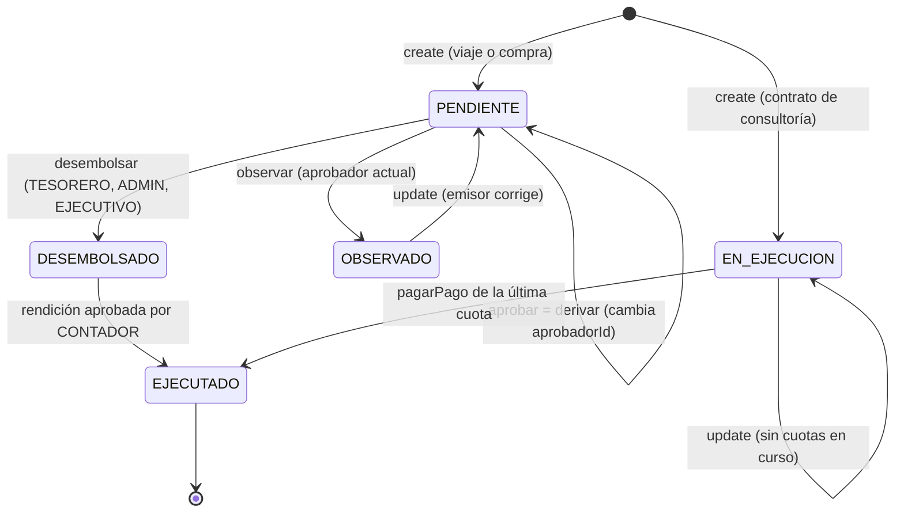
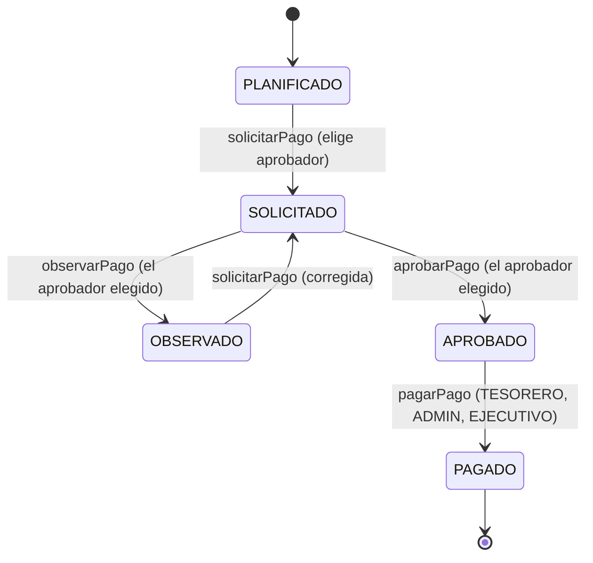
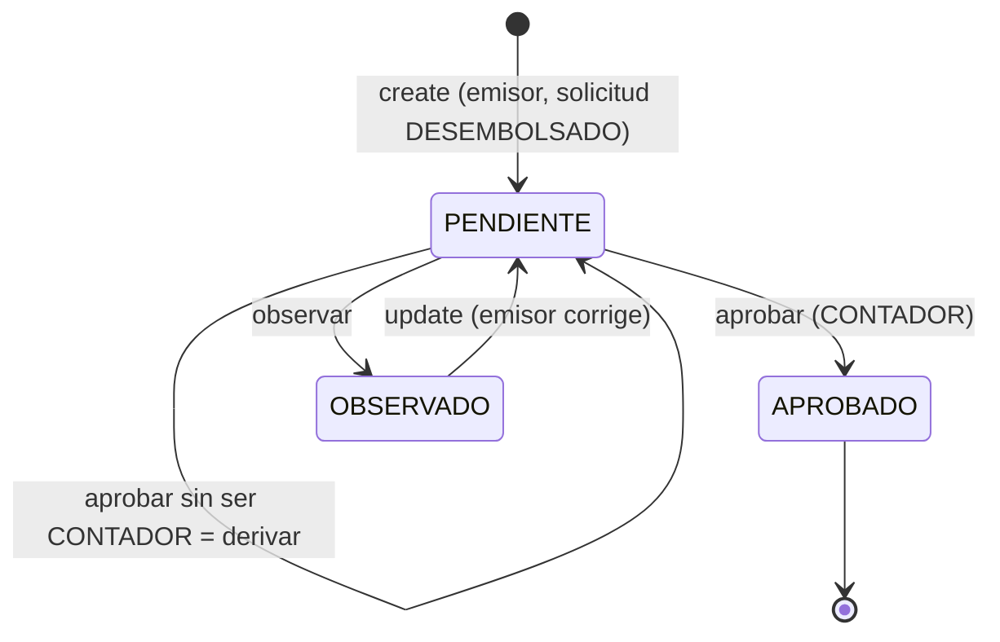
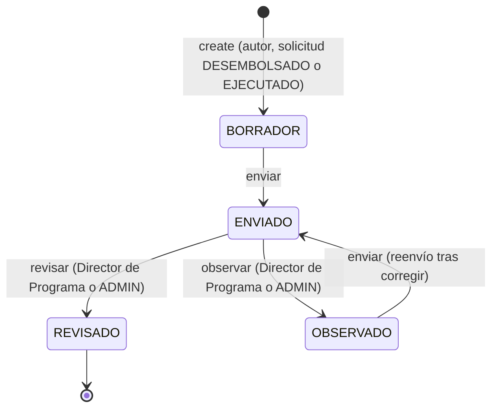
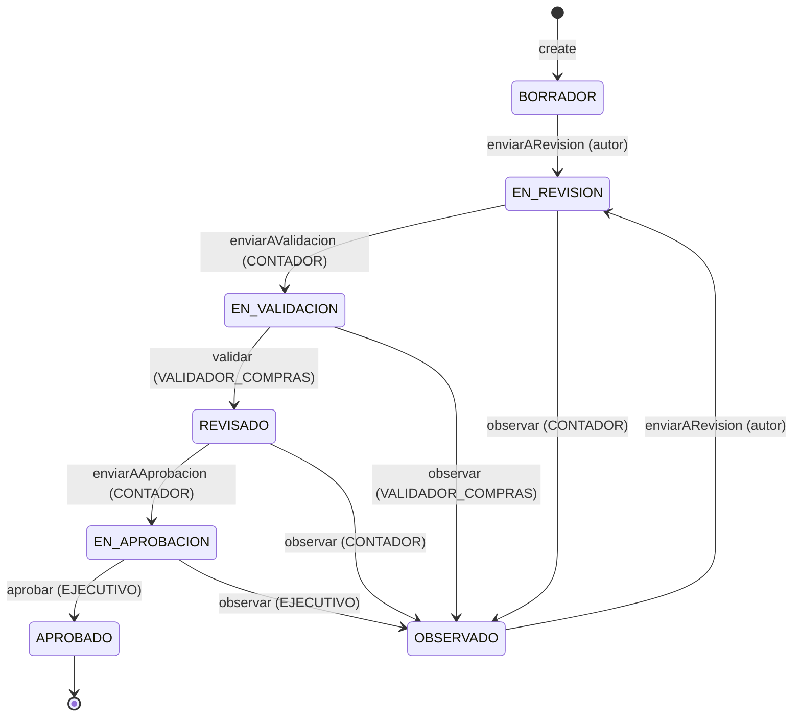

# Máquinas de estado

Los diagramas salen de los servicios del backend, no de las specs. Cada transición indica el
método que la hace y quién puede ejecutarla. Las transiciones viven **solo en el backend**: el
frontend muestra u oculta botones, pero el servicio vuelve a comprobar el estado de origen.

Resumen:

| Entidad                                                              | Enum                        | Servicio                            |
| -------------------------------------------------------------------- | --------------------------- | ----------------------------------- |
| Solicitud                                                            | `EstadoSolicitud`           | `solicitudes.service.ts`            |
| Cuota de consultoría                                                 | `EstadoPagoParcial`         | `solicitudes.service.ts`            |
| Rendición                                                            | `EstadoRendicion`           | `rendiciones.service.ts`            |
| Informe de Viaje                                                     | `EstadoInformeViaje`        | `informes-viaje.service.ts`         |
| Liquidación de Viáticos                                              | `EstadoLiquidacionViaticos` | `liquidaciones-viaticos.service.ts` |
| Cuadro comparativo                                                   | `EstadoCuadroComparativo`   | `cuadros-comparativos.service.ts`   |
| Plan de Viaje, cotización, orden de compra, declaración de movilidad | sin estado                  | —                                   |

## Solicitud

- **No hay `APROBADO`.** "Aprobar" una solicitud es **derivarla**: el estado sigue `PENDIENTE` y
  cambia `aprobadorId`, la bandeja en la que está. Se registra `DERIVADO` en el historial.
- **Viaje:** nace en la bandeja del Director de Programa (`aprobadorId = directorProgramaId`). El
  director solo puede derivarla a un usuario `TESORERO` (`destinoRevisionDirector`); si hay uno
  solo, se elige solo. `desembolsar` exige que la bandeja sea de un `TESORERO` y que quien
  desembolsa sea ese usuario o un `ADMIN`.
- **Compra:** se deriva al usuario que indique quien la tiene, sin restricción de rol.
- **Observar** devuelve la bandeja al emisor (`aprobadorId = usuarioEmisorId`) y guarda
  `observacion`. Solo el emisor edita, y solo en `OBSERVADO`; al guardar vuelve a `PENDIENTE` en
  la bandeja que elija.
- **Desembolsar** guarda `codigoDesembolso`, `urlComprobante` (obligatoria), `banco` y
  `fechaDesembolso`, y deja `aprobadorId = null`.
- **Contrato de consultoría:** una solicitud `COMPRA_SERVICIO` cuyo gasto trae cronograma de pagos
  (`esConsultoria()` en `solicitudes.helper.ts`). **Nace `EN_EJECUCION`, sin aprobador**, y no
  pasa por `DESEMBOLSADO`. Se corrige en `EN_EJECUCION` mientras ninguna cuota haya salido de
  `PLANIFICADO`.
- **Eliminar** (lógico) solo lo hace el emisor; se bloquea en `DESEMBOLSADO` y en un contrato con
  cuotas en curso.

:::caution Pendiente de confirmar
`remove` no bloquea `EJECUTADO`: según el código, el emisor puede eliminar una solicitud ya
ejecutada, aunque su rendición haya sumado al POA. Confirmar si es intencional.
:::

`ESTADOS_COMPROMISO_ACTIVO = [PENDIENTE, DESEMBOLSADO, EN_EJECUCION]` son los que comprometen
presupuesto. `OBSERVADO` **no** compromete: mientras está observada, su monto vuelve a estar
disponible. Ver [Presupuesto (POA)](./presupuesto-poa.md).

### Cuotas de consultoría (`PagoParcial`)

Las cuotas no tocan el POA, salvo la última: cuando no queda ninguna sin `PAGADO`, la solicitud
pasa a `EJECUTADO` y cada `SolicitudPresupuesto` suma su `subtotalPresupuestado` a
`Poa.montoEjecutado`, en la misma transacción.

## Rendición

- Pueden actuar `ADMIN`, `EJECUTIVO`, `CONTADOR`, `TESORERO` o el usuario en `aprobadorActualId`.
- **Solo un `CONTADOR` cierra.** Cualquier otro que "apruebe" debe indicar `derivadoAId`: la
  rendición sigue `PENDIENTE` en otra bandeja.
- Al aprobar el `CONTADOR`, en una sola transacción: valida que ningún POA supere su `costoTotal`,
  suma los `montoBruto` de los gastos a `Poa.montoEjecutado` agrupados por POA, pone la rendición en
  `APROBADO` y la solicitud en `EJECUTADO`.
- Observar devuelve la bandeja al emisor.

:::caution Pendiente de confirmar

- `RECHAZADO` existe en el enum, pero **ningún servicio lo asigna**: hoy no hay rechazo de
  rendiciones.
- `observar` no comprueba el estado de origen, y `aprobar` solo rechaza si ya está `APROBADO`. Leyendo
  el código, se podría observar una rendición aprobada (sin revertir el POA) o aprobar una
  observada. Confirmar si la interfaz lo impide y si debe impedirlo el backend.
  :::

## Informe de Viaje y Liquidación de Viáticos

Los dos tienen el mismo ciclo (`EstadoInformeViaje` y `EstadoLiquidacionViaticos` son idénticos):

- Nacen de una solicitud de viaje **propia** en `DESEMBOLSADO` o `EJECUTADO`
  (`ESTADOS_SOLICITUD_INFORMABLE`), uno por solicitud (`solicitudId @unique`).
- Editables en `BORRADOR` y `OBSERVADO` (`ESTADOS_EDITABLES` de cada servicio).
- Revisa el `directorProgramaId` elegido por el autor. No puede ser el propio autor ni un
  `TESORERO`.
- Un documento `REVISADO` no se elimina.
- **Liquidación:** solo una `REVISADO` exporta gastos a la rendición
  (`GET /liquidaciones-viaticos/solicitud/:solicitudId/gastos-lv`), un gasto `LV` por hoja y
  partida, con `hojaLiquidacionId` para no duplicarlo.
- **Informe:** la rendición lo muestra o avisa si falta, pero no bloquea.

## Cuadro comparativo

- Roles en el servicio: `ROLES_REVISOR = [CONTADOR, ADMIN]`,
  `ROLES_VALIDADOR = [VALIDADOR_COMPRAS, ADMIN]`, `ROLES_APROBADOR = [EJECUTIVO, ADMIN]`. `ADMIN`
  puede actuar en los tres papeles.
- **Ojo con el orden:** la revisión (`CONTADOR`) va **antes** que la validación
  (`VALIDADOR_COMPRAS`), y `REVISADO` es el estado que deja el **validador**.
- `observar` solo vale para el rol que corresponde al estado actual, y guarda
  `motivoObservacion`. Reenviar limpia el motivo.
- Solo `BORRADOR` y `OBSERVADO` son editables (`ESTADOS_EDITABLES`).
- El PDF (ANEXO 11) tiene tres firmas aunque el flujo tenga cinco pasos. Ver
  [Firmas](../documentos/firmas.md).

## Cotización y orden de compra

No tienen estado:

- **Cotización:** se crea, edita y elimina (lógicamente) libremente por su autor.
- **Orden de compra:** `GET /ordenes-compra/prefill/:cuadroId` solo prellena desde
  un cuadro `APROBADO`; `create` acepta `cuadroComparativoId` opcional **sin** volver a validar el
  estado del cuadro.

:::caution Pendiente de confirmar
Que `create` no exija un cuadro `APROBADO` puede ser intencional (órdenes sin cuadro, para compras
exentas) o una brecha.
:::

## Plan de Viaje

Sin estado desde la spec 023. "Completo" e "incompleto" se calculan
(`planes-viaje.helper.ts`), y "vinculado" se deriva de `Solicitud.planViajeId`. Editable mientras no
respalde una solicitud activa; si la respalda, solo cuando esa solicitud está `OBSERVADO`.
