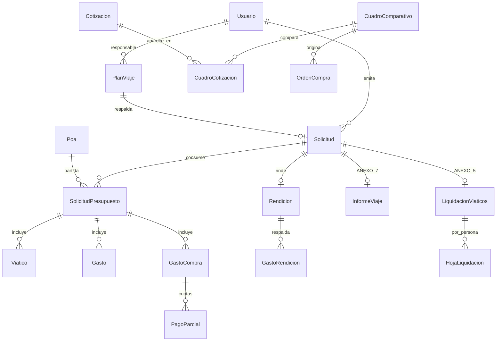

# Modelo de datos

La fuente única es `prisma/schema.prisma` del backend: **42 modelos** y 16 enums sobre
PostgreSQL. Esta página es un resumen por dominio; el diagrama completo está en `ERD.md` del
backend (autogenerado, ver [Convenciones](./convenciones.md#erdmd)).

## Vista de conjunto

## Usuarios y organización

| Modelo                | Qué guarda                                                                                                                                                                                                                                                                                    |
| --------------------- | --------------------------------------------------------------------------------------------------------------------------------------------------------------------------------------------------------------------------------------------------------------------------------------------- |
| `Usuario`             | Email único, hash de contraseña, `nombreCompleto`, `rol` (`Rol`), `cargo`, `ci`, `sede` (`Sede`). Tiene una relación con nombre por cada papel que cumple: emisor, aprobador, director de programa, beneficiario, revisor de informes y liquidaciones, etc.                                   |
| `HistorialAprobacion` | Bitácora de acciones (`TipoAccionHistorial`: `CREADO`, `DERIVADO`, `OBSERVADO`, `CORREGIDO`, `APROBADO`, `ENVIADO`, `VALIDADO`, `RECHAZADO`) con actor, destinatario y comentario. Un registro apunta a **una** de estas entidades: solicitud, rendición, cuadro, plan, informe o liquidación |
| `Notificacion`        | Aviso a un usuario: `tipo` (`TipoNotificacion`), `urlDestino` y vínculo opcional al registro que la originó                                                                                                                                                                                   |

## Presupuesto (POA)

| Modelo                              | Qué guarda                                                                                                                                                                                                                                    |
| ----------------------------------- | --------------------------------------------------------------------------------------------------------------------------------------------------------------------------------------------------------------------------------------------- |
| `Proyecto`, `Grupo`, `Partida`      | Los tres niveles de la estructura programática. `Proyecto` puede tener una `CuentaBancaria`                                                                                                                                                   |
| `EstructuraProgramatica`            | Combinación única `proyecto + grupo + partida`                                                                                                                                                                                                |
| `Actividad`, `CodigoPresupuestario` | Descripción de la actividad y código presupuestario de cada línea                                                                                                                                                                             |
| `Poa`                               | Una línea del POA: `codigoPoa`, `cantidad`, `costoUnitario`, `costoTotal`, `montoEjecutado`, `estado` (`ACTIVO`/`BLOQUEADO`)                                                                                                                  |
| `SolicitudPresupuesto`              | Tabla puente solicitud ↔ POA (`@@unique([solicitudId, poaId])`) con `subtotalNeto` y `subtotalPresupuestado`. Es "la partida" de la solicitud: de ella cuelgan viáticos, gastos, gastos de compra, gastos de rendición y filas de liquidación |
| `PartidaContable`                   | Plan de cuentas contable, jerárquico (`parentId`). Se asigna a los gastos de rendición                                                                                                                                                        |
| `CuentaBancaria`                    | Cuentas de la institución                                                                                                                                                                                                                     |

No hay dimensión de gestión (año) en `Poa`: solo puede existir un POA a la vez. Ver
[Presupuesto (POA)](./presupuesto-poa.md).

## Viajes

| Modelo                                                        | Qué guarda                                                                                                                                                      |
| ------------------------------------------------------------- | --------------------------------------------------------------------------------------------------------------------------------------------------------------- |
| `PlanViaje`                                                   | ANEXO 1. Sin estado. Respalda como máximo una solicitud (`Solicitud.planViajeId @unique`)                                                                       |
| `Planificacion`                                               | Una actividad del plan: fechas, días calculados, cantidad de personas institucionales y de terceros, participantes institucionales (N:M con `Usuario`)          |
| `Solicitud`                                                   | La solicitud de fondos. Ver abajo                                                                                                                               |
| `Viatico`                                                     | Línea de viático: `Concepto` (tarifa), `tipoDestino` (`INSTITUCIONAL`/`TERCEROS`), días, personas, montos e impuestos. Referencia las `Planificacion` que cubre |
| `Hospedaje`                                                   | Alojamiento: personas, noches, costo por noche, documento, impuestos. Cuelga directamente del `Poa`, no de `SolicitudPresupuesto`                               |
| `Gasto`                                                       | Otro gasto del viaje: `TipoGasto`, documento, cantidad, montos e impuestos (`iva13`, `it3`, `iue5`)                                                             |
| `PersonaExterna`                                              | Tercero que participa (nombre, procedencia), opcionalmente ligado a una `Planificacion`                                                                         |
| `Concepto`                                                    | Catálogo de tarifas de viático: `precioInstitucional`, `precioTerceros`, `moneda` (`BOB`/`USD`)                                                                 |
| `InformeViaje` + `ActividadInformeViaje`                      | ANEXO 7 y sus filas. 1:1 con la solicitud                                                                                                                       |
| `LiquidacionViaticos` + `HojaLiquidacion` + `FilaLiquidacion` | ANEXO 5: una hoja por persona (`@@unique([liquidacionId, usuarioId])`) y filas por concepto y partida                                                           |
| `DeclaracionMovilidad` + `DetalleMovilidad`                   | ANEXO 6. No se vincula a una solicitud                                                                                                                          |

### `Solicitud`

Campos que conviene conocer:

| Campo                                                            | Significado                                                                                                             |
| ---------------------------------------------------------------- | ----------------------------------------------------------------------------------------------------------------------- |
| `codigoSolicitud`                                                | `SOL-AAAA-NNN`, correlativo por año, generado en la transacción de alta                                                 |
| `tipo`                                                           | `VIAJE` o `COMPRA_SERVICIO`                                                                                             |
| `estado`                                                         | `EstadoSolicitud`                                                                                                       |
| `usuarioEmisorId`                                                | Quien la creó                                                                                                           |
| `aprobadorId`                                                    | **Quién la tiene en su bandeja ahora**. Cambia al derivar, vuelve al emisor al observar, queda en `null` al desembolsar |
| `directorProgramaId`                                             | El Director de Programa elegido por el emisor. No cambia al derivar; firma "Revisado por"                               |
| `usuarioBeneficiadoId`                                           | Hoy siempre el emisor                                                                                                   |
| `montoTotalNeto`, `montoTotalPresupuestado`                      | Líquido y bruto (con impuestos). El bruto es el que compromete el POA                                                   |
| `codigoDesembolso`, `urlComprobante`, `banco`, `fechaDesembolso` | Datos del desembolso                                                                                                    |
| `urlCuadroComparativo`, `urlCotizaciones`                        | Enlaces de respaldo de una compra (texto, no relación)                                                                  |
| `planViajeId`                                                    | Plan del que nace un viaje                                                                                              |

## Rendición

| Modelo              | Qué guarda                                                                                                                                                                                                                                      |
| ------------------- | ----------------------------------------------------------------------------------------------------------------------------------------------------------------------------------------------------------------------------------------------- |
| `Rendicion`         | 1:1 con la solicitud (`solicitudId @unique`). `montoRespaldado`, `saldoLiquido` (positivo: a devolver; negativo: falta respaldo), `estado`, `aprobadorActualId`, `comprobanteUrl`                                                               |
| `GastoRendicion`    | Comprobante rendido: `tipoDocumento` (`TipoDocumento`), número, fecha, proveedor, `monto`, `montoBruto`, `montoImpuestos`, `montoNeto`, la partida (`SolicitudPresupuesto`), la partida contable y, si viene de un ANEXO 5, `hojaLiquidacionId` |
| `DeclaracionJurada` | Gasto sin comprobante declarado dentro de la rendición: fecha, detalle y monto                                                                                                                                                                  |

`TipoDocumento`: `FACTURA`, `RECIBO`, `BOLETA`, `LV` (liquidación de viáticos), `DJ` (declaración
jurada), `PPT` / `PAT` / `PVT` (planillas de pasajes, alimentación y viáticos de terceros).

## Compras y servicios

| Modelo                            | Qué guarda                                                                                                                                     |
| --------------------------------- | ---------------------------------------------------------------------------------------------------------------------------------------------- |
| `Cotizacion` + `LineaCotizacion`  | Cotización de un proveedor (datos del proveedor como texto libre, `tipo` `PROPIA`/`EXTERNA`, `emiteFactura`, `total`) y sus líneas. Sin estado |
| `CuadroComparativo`               | ANEXO 11: `estado` (`EstadoCuadroComparativo`), cotización recomendada, `totalRecomendado`, `motivoObservacion`                                |
| `CuadroCotizacion`                | Columna del cuadro: una cotización dentro de un cuadro                                                                                         |
| `CuadroItem`                      | Fila del cuadro: ítem pedido, con su cotización ganadora                                                                                       |
| `CuadroPrecio`                    | Celda: precio de una cotización para un ítem (`@@unique([cuadroItemId, cuadroCotizacionId])`)                                                  |
| `OrdenCompra` + `OrdenCompraItem` | ANEXO 12, opcionalmente ligada al cuadro. Sin estado                                                                                           |
| `GastoCompra`                     | Línea de una solicitud `COMPRA_SERVICIO`: cantidad, costo, `total` (líquido), `montoPresupuestado` (bruto), impuestos                          |
| `PagoParcial`                     | Cuota de un contrato de consultoría, con su propio ciclo (`EstadoPagoParcial`)                                                                 |

## Catálogos de apoyo

`TipoGasto` (código único; el seed `prisma/seeds/TipoGasto.csv` carga `COMPRA`, `ALQUILER`,
`SERVICIO`, `PEAJE` y `AUTO_COMPRA`, los mismos que reconoce `solicitudes.helper.ts`),
`Concepto`, `CodigoPresupuestario`, `CuentaBancaria`, `PartidaContable`.
