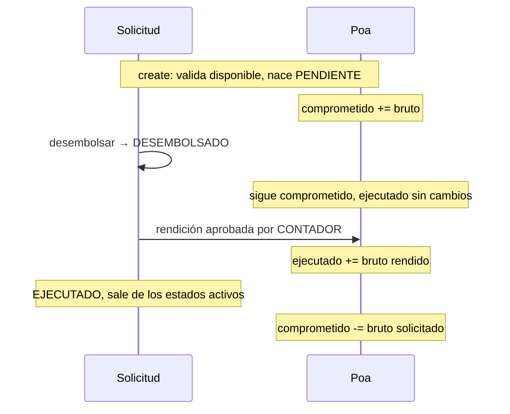

# Presupuesto (POA)

Cada línea del POA (`Poa`) tiene un techo (`costoTotal`) y un acumulado de lo gastado
(`montoEjecutado`). Lo comprometido y lo disponible **no se guardan**: se calculan al vuelo.

## Los tres montos

| Monto            | Cómo se obtiene                                                                                                    | Dónde      |
| ---------------- | ------------------------------------------------------------------------------------------------------------------ | ---------- |
| **Ejecutado**    | Campo `Poa.montoEjecutado` (`Decimal(10,2)`, por defecto 0)                                                        | Persistido |
| **Comprometido** | Suma de `SolicitudPresupuesto.subtotalPresupuestado` de las solicitudes no borradas en `ESTADOS_COMPROMISO_ACTIVO` | Calculado  |
| **Disponible**   | `costoTotal - montoEjecutado - comprometido`                                                                       | Calculado  |

```ts title="src/common/constants/financial.constants.ts"
export const ESTADOS_COMPROMISO_ACTIVO: EstadoSolicitud[] = [
  EstadoSolicitud.PENDIENTE,
  EstadoSolicitud.DESEMBOLSADO,
  EstadoSolicitud.EN_EJECUCION,
];
```

Lo que se compromete y se ejecuta es siempre el **bruto** (`subtotalPresupuestado`, con
impuestos), no el líquido.

## Cuándo se mueve `montoEjecutado`

`montoEjecutado` **no cambia al desembolsar**. Solo se mueve en dos lugares:

| Evento                                                | Servicio                       | Cuánto suma                                                                                                 |
| ----------------------------------------------------- | ------------------------------ | ----------------------------------------------------------------------------------------------------------- |
| Un `CONTADOR` aprueba la rendición                    | `RendicionesService.aprobar`   | Los `montoBruto` de los `GastoRendicion`, agrupados por la partida (`SolicitudPresupuesto`) y luego por POA |
| Se paga la última cuota de un contrato de consultoría | `SolicitudesService.pagarPago` | El `subtotalPresupuestado` de cada `SolicitudPresupuesto` de la solicitud                                   |

:::info
`CLAUDE.md` dice que `monto_ejecutado` se actualiza "al desembolsar y al rendir". En el código el
desembolso no lo toca: durante `DESEMBOLSADO` el monto cuenta como **comprometido**, y pasa a
**ejecutado** al aprobarse la rendición. El campo se llama `montoEjecutado` en Prisma y también en
la base (no hay `@map`).
:::

### Ciclo de una solicitud de viaje



Si se desembolsaron Bs 1.000 y se rindieron Bs 800, se ejecutan 800 y los 200 vuelven a estar
disponibles al salir la solicitud de los estados activos.

Una solicitud `OBSERVADO` no está en `ESTADOS_COMPROMISO_ACTIVO`: mientras espera corrección, su
monto queda libre y otra solicitud podría tomarlo.

## Los dos bloqueos

### Al crear la solicitud

Dentro de la transacción de `SolicitudesService.create`, por cada POA:

```ts title="src/solicitudes/solicitudes.service.ts (resumen)"
const saldoDisponible = poa.costoTotal
  .sub(poa.montoEjecutado)
  .sub(comprometido);
if (montoSolicitado.gt(saldoDisponible)) {
  throw new BadRequestException('Saldo insuficiente en el POA especificado');
}
```

Es un límite duro: ningún rol lo salta.

:::warning
La validación de saldo **solo está en `create`**. `update` (la corrección de una solicitud
observada) vuelve a ponerla en `PENDIENTE`, y por tanto a comprometer presupuesto, sin repetirla.
Como `OBSERVADO` no compromete, otra solicitud pudo tomar ese saldo entretanto: una solicitud
corregida puede dejar el disponible en negativo. El techo se vuelve a imponer recién al aprobar la
rendición.
:::

### Al aprobar la rendición

Antes de sumar, `RendicionesService.aprobar` comprueba para cada POA que
`montoEjecutado + montoAEjecutar` no supere `costoTotal`. Si alguno lo supera, falla todo con un
mensaje que indica cuánto queda. No hay reversión de una rendición aprobada, por eso la guarda va
antes de escribir.

## Lectura del saldo

`PoaService` añade `montoComprometido`, `saldoDisponible` y `tieneCompromisos` a cada POA que
devuelve. En los listados lo hace con un solo `groupBy` para todos los POA
(`batchEnrichWithSaldos`), no con una consulta por fila.

Esos dos montos salen como `number` (`.toNumber()`): son para mostrar. Las decisiones se toman en
las transacciones con `Decimal`.

## Recalibrar `montoEjecutado`

Si el acumulado se desajusta (por ejemplo tras una corrección manual de datos), el script
`src/scripts/recalibrar-monto-ejecutado.ts` lo recalcula desde cero: suma los `montoBruto` de los
gastos de rendiciones `APROBADO` de solicitudes no borradas, por POA, dentro de una transacción.

```bash
pnpm maintenance:recalibrar-poa-ejecutado
```

:::warning
El script solo suma rendiciones aprobadas. **No incluye los contratos de consultoría** cerrados por
cuotas (que ejecutan sin rendición): si hay contratos `EJECUTADO`, recalibrar borraría esa parte del
ejecutado. Revisar el script antes de usarlo en una base con contratos.
:::

## Limitaciones conocidas

- **No hay gestión (año)** en `Poa`, `Actividad` ni `EstructuraProgramatica`: solo puede existir un
  POA a la vez.
- El POA se carga por seed (`prisma/seeds/POA.csv`). Hay endpoints de alta y edición (`ADMIN`,
  `EJECUTIVO`), pero no pantalla en el frontend.
- `EstadoPoa` (`ACTIVO`/`BLOQUEADO`): los selectores de grupo, partida e ítem del formulario de
  solicitud solo ofrecen POA `ACTIVO` (`poa.service.ts`, `grupos.service.ts`).
