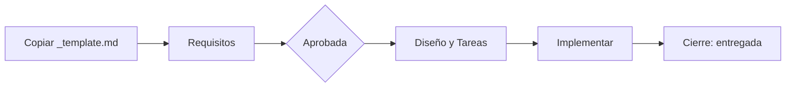

# Convenciones

Reglas de trabajo comunes a los dos repos: commits, ramas y el flujo de especificaciones.
Las convenciones de código (vocabulario de dominio en español, `Prisma.Decimal`, soft delete,
nombres de componentes) están en `AGENTS.md`, en la raíz del workspace y en cada repo.

## Commits

Los dos repos exigen **Conventional Commits**, comprobados por commitlint en el hook
`commit-msg` de husky.

```text
tipo: descripción corta en minúsculas
tipo(ámbito): descripción corta
```

### Tipos permitidos

| Tipo       | Uso                                                | Backend | Frontend |
| ---------- | -------------------------------------------------- | ------- | -------- |
| `feat`     | Funcionalidad nueva                                | sí      | sí       |
| `fix`      | Arreglo de un bug                                  | sí      | sí       |
| `docs`     | Documentación                                      | sí      | sí       |
| `style`    | Formato, sin cambiar lógica                        | sí      | sí       |
| `refactor` | Mejora de código sin cambiar comportamiento        | sí      | sí       |
| `perf`     | Rendimiento                                        | sí      | sí       |
| `test`     | Tests                                              | sí      | sí       |
| `chore`    | Mantenimiento: dependencias, Docker, configuración | sí      | sí       |
| `ci`       | Integración continua                               | sí      | sí       |
| `revert`   | Revertir un commit                                 | sí      | sí       |
| `build`    | Sistema de build                                   | **no**  | sí       |

La diferencia sale de la configuración:

```js title="Conservacion-amazonica-backend/commitlint.config.mjs (extracto)"
extends: ['@commitlint/config-conventional'],
rules: {
  'type-case': [2, 'always', 'lower-case'],
  'subject-empty': [2, 'never'],
  'type-enum': [2, 'always', ['feat', 'fix', 'docs', 'style', 'refactor',
                              'test', 'chore', 'perf', 'ci', 'revert']],
},
```

```js title="Conservacion-amazonica-frontend/commitlint.config.cjs"
module.exports = {
  extends: ['@commitlint/config-conventional'],
};
```

El frontend usa la configuración convencional sin cambios, que sí admite `build`. Para que un
mismo tipo valga en los dos repos, conviene no usar `build`.

### Hooks de husky

| Hook         | Backend                            | Frontend                         |
| ------------ | ---------------------------------- | -------------------------------- |
| `pre-commit` | `npx lint-staged`                  | `pnpm exec lint-staged`          |
| `commit-msg` | `npx --no -- commitlint --edit $1` | `pnpm exec commitlint --edit $1` |

lint-staged corrige solo los archivos preparados:

| Repo     | Dónde se configura                  | Qué ejecuta                                                                                                |
| -------- | ----------------------------------- | ---------------------------------------------------------------------------------------------------------- |
| backend  | `package.json`, clave `lint-staged` | `*.ts`: `eslint --fix` y `prettier --write`                                                                |
| frontend | `.lintstagedrc`                     | `*.js, *.jsx, *.ts, *.tsx`: `eslint --fix` y `prettier --write`; `*.json, *.css, *.md`: `prettier --write` |

:::warning No saltarse los hooks
No usar `--no-verify`. Si un hook falla, se corrige la causa. El CI vuelve a pasar lint y tipos,
así que saltarse el hook solo aplaza el error al despliegue.
:::

Husky se instala con el script `prepare` al hacer `pnpm install`. En las imágenes Docker se
desactiva (`HUSKY=0`) porque no hay `.git`.

## Ramas

| Rama       | Para qué                                                               | Despliega                                      |
| ---------- | ---------------------------------------------------------------------- | ---------------------------------------------- |
| `develop`  | Trabajo diario, en los dos repos                                       | **no**                                         |
| `main`     | Publicación                                                            | **sí**: cada push dispara el CI/CD de ese repo |
| `feat/...` | Una feature con spec (por ejemplo `feat/documentacion` en la spec 026) | no                                             |

Publicar es un acto deliberado: fusionar `develop` en `main` y empujar.

```bash
git checkout main
git merge develop
git push
git checkout develop
```

Cada repo despliega solo su servicio. Si un cambio toca backend y frontend, hay que publicar
los dos, y normalmente **primero el backend**, para que el frontend nuevo no llame a endpoints
que todavía no existen.

:::tip Cerrar lo pendiente antes de empezar
Antes de empezar una tarea nueva, commitear y empujar a `develop` lo que esté a medias, para no
mezclar cambios de dos trabajos en el mismo commit.
:::

## Flujo SDD (`specs/`)

El proyecto trabaja con **Spec-Driven Development**. Toda feature nueva empieza por un archivo
en `specs/`, en la raíz del workspace, aprobado **antes** de escribir código.

`specs/` no está dentro de ningún repo: la raíz del workspace no es un repositorio git. No tiene
historial ni respaldo automático; hay que copiarla aparte de vez en cuando.



1. **Crear.** Copiar `specs/_template.md` a `specs/NNN-slug-en-kebab-case.md`, con el siguiente
   número libre. Los números no se reutilizan, ni siquiera si la spec se descarta.
2. **Requisitos.** Qué y por qué, en lenguaje de negocio y con el vocabulario del dominio.
   **Sin tecnología**: nada de Prisma, endpoints ni componentes. Criterios de aceptación
   numerados y verificables.
3. **Aprobar.** `Estado: aprobada`. Es el punto de control antes de diseñar.
4. **Diseñar.** Rellenar _Diseño_ (datos, backend, frontend, decisiones, riesgos) y _Tareas_.
   `Estado: en curso`.
5. **Implementar.** Ir marcando las tareas. Al cerrar, `Estado: entregada` y los commits en
   _Cierre_.

Estados de una spec: `borrador`, `aprobada`, `en curso`, `entregada`, `descartada`.

Documentos de apoyo:

| Archivo                 | Qué es                                                                                                  |
| ----------------------- | ------------------------------------------------------------------------------------------------------- |
| `specs/README.md`       | El proceso completo, el índice y el backlog de números reservados                                       |
| `specs/000-baseline.md` | Lo que ya está construido. Leerlo antes de escribir una spec                                            |
| `specs/sistema/`        | Capa normativa: qué debe hacer el sistema según ACEAA, con marcas `[BRECHA]`, `[DIVERGE]` y `[ABIERTO]` |
| `specs/_template.md`    | Plantilla de una spec de feature                                                                        |

Quedan **fuera** del proceso los arreglos de bugs y el mantenimiento: van directo a rama y
commit.

### Definición de hecho

Una spec pasa a `entregada` cuando se cumple todo esto:

- [ ] Todas las tareas de la spec marcadas.
- [ ] `pnpm run lint` sin errores en los repos tocados.
- [ ] Tests del backend en verde (`pnpm run test`), con tests nuevos si se tocó lógica de
      servicio.
- [ ] Criterios de aceptación probados contra la app corriendo.
- [ ] `CHANGELOG.md` del backend actualizado.
- [ ] `specs/000-baseline.md` actualizado si cambió algo estructural: un módulo, un estado, un
      rol.
- [ ] `AGENTS.md` actualizado si cambió una convención o una máquina de estados.
- [ ] **Manual actualizado si cambió un flujo**: el de usuario si cambió lo que se ve o se hace;
      el técnico si cambió la arquitectura, el despliegue o la operación (ver
      [Este manual](./manual.md)).
- [ ] Cambios en `develop` y _Cierre_ de la spec con los commits.
