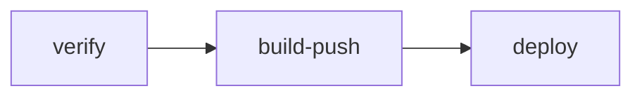

# CI/CD

Cada repo tiene un único workflow: `.github/workflows/deploy.yml`. Los dos siguen el mismo
esquema de tres jobs y cada uno despliega **solo su servicio**, sin tocar el del otro.

## Cuándo se dispara

```yaml title=".github/workflows/deploy.yml (extracto)"
on:
  push:
    branches: [main]
  workflow_dispatch:

concurrency:
  group: deploy-backend # deploy-frontend en el otro repo
  cancel-in-progress: false
```

- Solo **push a `main`**. `develop` no publica nada: llegar al VPS es fusionar `develop` en
  `main` (ver [Convenciones](../desarrollo/convenciones.md#ramas)).
- `workflow_dispatch` permite relanzarlo a mano desde la pestaña **Actions** de GitHub.
- `concurrency` encola los despliegues del mismo repo: dos a la vez dejarían el VPS en un
  estado indeterminado. No se cancela el que está en curso.

## Los tres jobs



### 1. `verify` (Verificar)

En un runner con Node 20 y pnpm:

| Paso                                     | Backend | Frontend                    |
| ---------------------------------------- | ------- | --------------------------- |
| `pnpm install --frozen-lockfile`         | sí      | sí                          |
| `npx prisma generate --generator client` | sí      | no                          |
| `npx tsc --noEmit`                       | sí      | sí                          |
| `pnpm lint`                              | sí      | sí                          |
| `pnpm test`                              | sí      | no (no hay tests unitarios) |

En el frontend se verifica antes de construir porque `next.config.ts` no ignora errores: un
fallo de tipos o de lint tumbaría el build de todas formas, pero más tarde.

:::warning El lockfile manda
`--frozen-lockfile` falla si `pnpm-lock.yaml` no coincide con el `package.json`. Después de
cambiar dependencias hay que commitear el lockfile.
:::

### 2. `build-push` (Construir y publicar imagen)

Construye la imagen con el `Dockerfile` de la raíz del repo y la publica en GHCR con dos
etiquetas:

```yaml title=".github/workflows/deploy.yml (extracto)"
- id: vars
  run: |
    echo "repo=ghcr.io/${GITHUB_REPOSITORY,,}" >> "$GITHUB_OUTPUT"
    echo "image=ghcr.io/${GITHUB_REPOSITORY,,}:sha-${GITHUB_SHA}" >> "$GITHUB_OUTPUT"
```

| Etiqueta       | Para qué                                                           |
| -------------- | ------------------------------------------------------------------ |
| `sha-<commit>` | **Inmutable.** Es la que se despliega y la que permite el rollback |
| `latest`       | Comodidad; el VPS no la usa                                        |

- `${GITHUB_REPOSITORY,,}` pasa el nombre a minúsculas: GHCR no acepta mayúsculas y los repos
  las tienen.
- El login a GHCR usa el `GITHUB_TOKEN` del propio workflow (permiso `packages: write`).
- Caché de capas de Docker en GitHub Actions (`type=gha`).
- En el frontend se pasan como `build-args` `NEXT_PUBLIC_BASE_PATH=/amzdesk` y
  `NEXT_PUBLIC_API_URL=/amzdesk/api`: rutas relativas, para que la imagen no quede atada a
  ningún dominio.

Con la spec 026, el job del frontend publica además la imagen del manual (ver
[El manual en producción](./manual-en-produccion.md)).

### 3. `deploy` (Desplegar en el VPS)

Entra al VPS por SSH (`appleboy/ssh-action`) y ejecuta:

```bash title="Script del job deploy (backend)"
set -e
cd /opt/amzdesk
sed -i "s|^BACKEND_IMAGE=.*|BACKEND_IMAGE=<imagen sha-commit>|" .env
docker compose pull backend
docker compose up -d backend
docker image prune -f
```

En el frontend es igual con `FRONTEND_IMAGE` y el servicio `frontend`. Es decir: el despliegue
**reescribe la línea de la imagen en el `.env` del VPS** y recrea solo ese contenedor.
`docker image prune -f` borra las imágenes que quedaron sin uso, porque el disco es limitado.

Después viene el **smoke test**.

## Smoke test dentro del VPS

La comprobación posterior al despliegue se ejecuta **dentro del VPS**, en la misma sesión SSH,
y no desde el runner de GitHub. El motivo: el proxy que está delante del VPS responde `403` a
las peticiones que llegan desde GitHub Actions (bloquea IP de centros de datos). Una comprobación
externa fallaría siempre sin decir nada del estado real del servicio.

La petición sale por el puerto 80 del host hacia `127.0.0.1`, así que **atraviesa el proxy
`edge`**: prueba el mismo camino que un navegador, no solo que el contenedor esté vivo.

| Repo     | Petición                                                                     | Espera         |
| -------- | ---------------------------------------------------------------------------- | -------------- |
| backend  | `GET http://127.0.0.1/amzdesk/api/health`                                    | `200`          |
| frontend | `GET http://127.0.0.1/amzdesk` siguiendo redirecciones (`-L --max-redirs 5`) | `200` al final |

- Reintenta hasta 24 veces cada 5 segundos (unos 2 minutos), porque el backend aplica las
  migraciones antes de levantar la API.
- Si no llega a `200`, imprime las últimas 50 líneas de `docker compose logs` del servicio y el
  job falla.
- El frontend entra por `/amzdesk` **siguiendo las redirecciones** y no directo a
  `/amzdesk/login`: una vez un bucle de redirecciones entre nginx y Next dejó la app inservible
  con el smoke test en verde. Con `--max-redirs`, un bucle agota los saltos y el código final
  deja de ser `200`.

:::info Un smoke test fallido no revierte
Si el smoke test falla, el contenedor nuevo **queda desplegado**: el job solo avisa. Hay que
revisar los logs y, si hace falta, volver a la versión anterior (ver
[Rollback](../operacion/rollback.md)).
:::

## Secretos del repositorio

Los dos repos necesitan los mismos secretos en **Settings, Secrets and variables, Actions**.
Aquí solo se listan los nombres:

| Secreto       | Qué es                                                   |
| ------------- | -------------------------------------------------------- |
| `VPS_HOST`    | Dirección del VPS                                        |
| `VPS_USER`    | Usuario SSH con acceso a Docker                          |
| `VPS_SSH_KEY` | Clave privada dedicada a los despliegues, sin passphrase |
| `VPS_PORT`    | Puerto SSH                                               |

`GITHUB_TOKEN` lo pone GitHub; no hay que crearlo. El VPS, en cambio, necesita su propio login
en GHCR con un token de solo lectura (`read:packages`), porque los paquetes nacen privados. El
procedimiento está en `deploy/README.md`.
