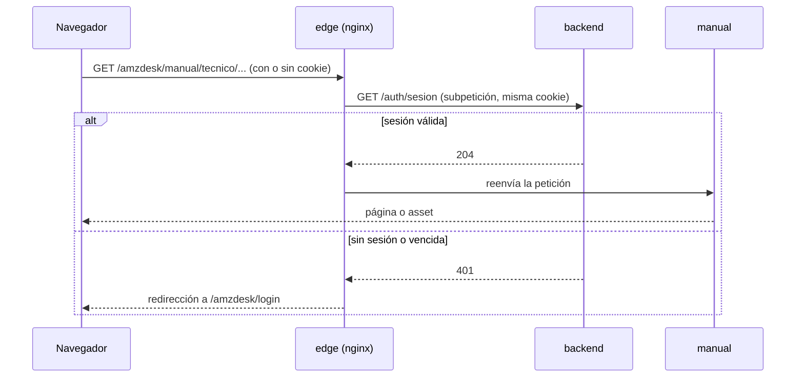

# El manual en producción

Los dos manuales se sirven desde una imagen propia, `manual`, en el mismo stack que la
aplicación. El manual de usuario es público; el técnico exige una sesión de AMZ Desk iniciada,
con cualquier rol.

## Qué se sirve y dónde

| Sitio             | URL                        | Acceso                                            |
| ----------------- | -------------------------- | ------------------------------------------------- |
| Manual de usuario | `/amzdesk/manual/`         | público, sin sesión                               |
| Manual técnico    | `/amzdesk/manual/tecnico/` | con sesión; sin ella, redirige a `/amzdesk/login` |

Son dos builds del mismo proyecto Docusaurus, cada uno con su `baseUrl`, sus assets y su índice
de búsqueda (ver [Este manual](../desarrollo/manual.md#por-qué-dos-sitios)). Así, proteger la
ruta `/amzdesk/manual/tecnico/` protege **todo** el contenido técnico: páginas, JS e índice de
búsqueda.

`/amzdesk/docs/` no se usa para esto: ya lo usa Next para los PDF de la Base Documental.

## La imagen `manual`

- `manual/Dockerfile`, en el repo del frontend, en varias etapas.
- Una etapa con Node compila los dos sitios (`pnpm run build`, que deja `build/usuario` y
  `build/tecnico`).
- La etapa final es `nginx:1.27-alpine` con `manual/nginx.conf`. Escucha en el puerto 80 y
  guarda los sitios con las mismas rutas que en el dominio: el de usuario en
  `/usr/share/nginx/html/amzdesk/manual/` y el técnico dentro, en `.../manual/tecnico/`. Así
  `edge` reenvía la ruta completa sin reescribirla.
- Cada sitio tiene su página 404; los assets (`/assets/`, con hash en el nombre) se cachean 30
  días.
- Healthcheck: `wget` a `/amzdesk/manual/`. Ocupa unos pocos MB de RAM (límite de 64 MB en el
  compose), importante en un VPS de 2 GB.

### Publicación en el CI

El workflow del frontend construye y publica también esta imagen, con el mismo esquema de
etiquetas que las demás:

```text
ghcr.io/<propietario>/<repo-del-frontend>-manual:sha-<commit>
```

y el job `deploy` actualiza el servicio `manual` después del `frontend`, **solo si el compose
del VPS ya tiene ese servicio** (`docker compose config --services`). Si la línea
`MANUAL_IMAGE=` no existe en el `.env`, la crea; si existe, la reemplaza. Si el compose aún no
tiene el servicio, el deploy sigue y deja un aviso en el log.

## El servicio en el compose

En `deploy/docker-compose.prod.yml` (repo del backend):

```yaml title="deploy/docker-compose.prod.yml"
manual:
  image: ${MANUAL_IMAGE:-ghcr.io/arano8/conservacion-amazonica-frontend-manual:latest}
  container_name: amzdesk_manual
  restart: unless-stopped
  mem_limit: 64m
  networks:
    - edge
```

El valor por defecto de `MANUAL_IMAGE` es a propósito: sin él, un `.env` que todavía no define
la variable dejaría el compose inválido y fallarían también los despliegues del backend y del
frontend.

Solo en la red `edge`: no habla con la base ni con la API. Quien consulta la sesión es el nginx
de `edge`, no el contenedor del manual.

## La protección del manual técnico

nginx comprueba la sesión con `auth_request` **en cada petición** al manual técnico: una
subpetición al backend que reenvía la cookie del navegador.



### El endpoint `GET /auth/sesion`

Está en `src/auth/auth.controller.ts` del backend y solo existe para esto:

- `204` si la cookie trae un JWT válido, `401` si no. Vale cualquier rol.
- `@SkipThrottle()`: cada página y cada asset del manual pasan por aquí, y todas las
  comprobaciones llegan desde la IP del proxy. Con rate limiting, navegar por el manual
  agotaría el cupo.

La cookie llega sin hacer nada especial porque su `Path` es `/amzdesk` (ver
[Proxy edge](./proxy-edge.md#la-cookie-de-sesión-y-el-prefijo)) y `auth_request` reenvía las
cabeceras de la petición original.

### Configuración de nginx

Extracto de `deploy/edge/nginx.conf`:

```nginx title="deploy/edge/nginx.conf"
location = /amzdesk/manual {
    return 301 /amzdesk/manual/;
}

location /amzdesk/manual/tecnico/ {
    auth_request /_amzdesk_sesion;
    error_page 401 = @amzdesk_login;

    set $amzdesk_manual http://amzdesk_manual:80;
    proxy_pass $amzdesk_manual;
    # (cabeceras Host y X-Forwarded-Proto)
    add_header Cache-Control "private, no-store" always;
}

location /amzdesk/manual/ {
    set $amzdesk_manual http://amzdesk_manual:80;
    proxy_pass $amzdesk_manual;
}

# Con una variable como destino, nginx usa la URL tal cual
location = /_amzdesk_sesion {
    internal;
    set $amzdesk_sesion http://amzdesk_backend:3000/auth/sesion;
    proxy_pass $amzdesk_sesion;
    proxy_pass_request_body off;
    proxy_set_header Content-Length "";
}

location @amzdesk_login {
    return 302 /amzdesk/login;
}
```

Notas:

- Las reglas de siempre siguen valiendo: destinos en variables por el `resolver`, y
  redirecciones relativas por `absolute_redirect off`.
- `/amzdesk/manual/tecnico/` gana sobre `/amzdesk/manual/` y este sobre `/amzdesk` por ser
  prefijos más largos. Sin el bloque del manual, `/amzdesk/manual/` caería en el frontend de
  Next y respondería 404.
- `auth_request` trata `2xx` como permitido y `401`/`403` como denegado. **Cualquier otra
  respuesta** (por ejemplo, el backend caído) se convierte en un `500`: si el backend no
  responde, el manual técnico tampoco.
- El módulo `auth_request` viene compilado en la imagen oficial `nginx:alpine`.

- `/amzdesk/manual` sin barra final redirige a `/amzdesk/manual/`; sin ese bloque caería en
  Next por prefijo.
- El manual técnico sale con `Cache-Control: private, no-store`: ningún cache intermedio debe
  guardar contenido que exige sesión.
- La redirección al login no recuerda la página de origen: tras iniciar sesión, se vuelve a
  abrir el manual técnico desde el panel lateral de AMZ Desk.

## Pasos a mano en el VPS (una sola vez)

La primera vez hay que configurar el VPS a mano. El orden no rompe nada: el CI no toca el
servicio `manual` hasta que el compose del VPS lo tenga, y el compose tiene un valor por defecto
para la imagen.

1. **Publicar la imagen:** push a `main` del frontend. El deploy avisa en el log de que el
   compose del VPS aún no tiene el servicio `manual`.
2. **Compose:** copiar `deploy/docker-compose.prod.yml` del backend como
   `/opt/amzdesk/docker-compose.yml` y levantar el servicio:

   ```bash
   cd /opt/amzdesk
   docker compose pull manual
   docker compose up -d manual
   ```

3. **Configuración de `edge`:** copiar `deploy/edge/nginx.conf` a `/opt/edge/nginx.conf`,
   validarla y recargar:

   ```bash
   cd /opt/edge
   docker compose exec nginx nginx -t
   docker compose exec nginx nginx -s reload
   ```

4. **Comprobar** desde el propio VPS:

   ```bash
   curl -I http://127.0.0.1/amzdesk/manual/            # 200
   curl -I http://127.0.0.1/amzdesk/manual/tecnico/    # 302 a /amzdesk/login
   curl -fsS http://127.0.0.1/amzdesk/api/health       # la API sigue respondiendo
   curl -sL -o /dev/null -w '%{http_code}
   ' http://127.0.0.1/amzdesk   # 200
   ```

   Y desde un navegador con sesión iniciada, abrir el manual técnico y probar el buscador.

Desde el siguiente push a `main`, el CI fija `MANUAL_IMAGE` con la etiqueta `sha-<commit>` y
publica y despliega el manual sin pasos a mano.
Los cambios futuros de `deploy/edge/nginx.conf` o del compose siguen siendo manuales.
