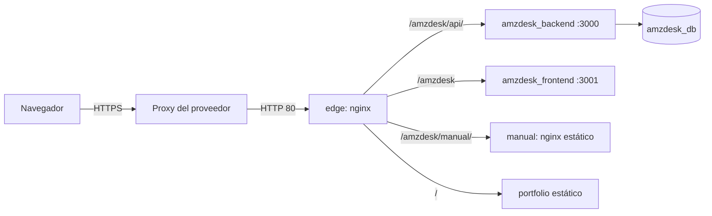

# Visión general del despliegue

AMZ Desk corre en un VPS con Docker, detrás de un proxy nginx compartido. Las imágenes las
construye GitHub Actions, las publica en GitHub Container Registry (GHCR) y el VPS solo las
descarga. Nada se compila en el servidor.

La guía de instalación desde cero está en `Conservacion-amazonica-backend/deploy/README.md`.
Esta sección explica cómo funciona; la de [Operación](../operacion/logs-y-estado.md) cuenta
qué hacer en el día a día.

## Cómo llega una petición

- El **HTTPS lo termina un proxy anterior al VPS**, que no controlamos. Dentro del VPS todo es
  HTTP en el puerto 80.
- El dominio se reparte por **prefijos**: AMZ Desk vive bajo `/amzdesk`, junto a otros
  sistemas del mismo servidor.
- El único contenedor que publica un puerto en el host es el nginx de `edge`.

## Dos stacks de compose

| Directorio en el VPS | Stack     | Qué contiene                           | Origen en el repo                            |
| -------------------- | --------- | -------------------------------------- | -------------------------------------------- |
| `/opt/edge`          | `edge`    | nginx compartido y el sitio de la raíz | `deploy/edge/` del backend                   |
| `/opt/amzdesk`       | `amzdesk` | base de datos, API, frontend y manual  | `deploy/docker-compose.prod.yml` del backend |

Están unidos por una red de Docker externa llamada `edge`. La crea el stack `edge`, así que
este se levanta **primero**; el de la aplicación solo la referencia.

El proxy va aparte a propósito: si viviera dentro del stack de la aplicación, cada despliegue
de AMZ Desk reiniciaría el proxy de todos los demás sitios del dominio.

## Qué se despliega solo y qué no

| Pieza                                  | Cómo se actualiza                                                                  |
| -------------------------------------- | ---------------------------------------------------------------------------------- |
| Imagen del backend                     | Automático: push a `main` del backend                                              |
| Imagen del frontend                    | Automático: push a `main` del frontend                                             |
| Imagen del manual                      | Automático: push a `main` del frontend (spec 026)                                  |
| Migraciones de la base                 | Automático: al arrancar el contenedor del backend                                  |
| `docker-compose.yml` de `/opt/amzdesk` | **A mano**: copiar `deploy/docker-compose.prod.yml`                                |
| `.env` de `/opt/amzdesk`               | **A mano**: vive solo en el VPS                                                    |
| Configuración de `edge` (`nginx.conf`) | **A mano**: copiar y recargar nginx                                                |
| Seed de la base                        | **A mano**, una vez (ver [Migraciones y seed](../operacion/migraciones-y-seed.md)) |

## Páginas de esta sección

- [CI/CD](./ci-cd.md): los workflows de GitHub Actions.
- [Imágenes Docker](./imagenes.md): los `Dockerfile` del backend y el frontend.
- [Stack de producción](./stack-produccion.md): el compose y el `.env` del VPS.
- [Proxy edge](./proxy-edge.md): la configuración de nginx.
- [El manual en producción](./manual-en-produccion.md): la imagen del manual y su protección.
