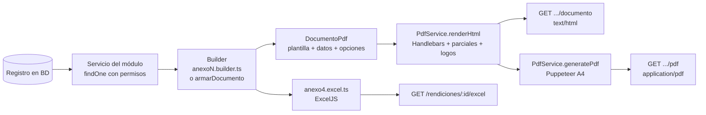

# Generación de documentos

Cada documento del sistema corresponde a un anexo del _Manual de Procedimientos Administrativos_
de ACEAA y debe poder imprimirse en un PDF que un auditor reconozca. Todos se generan en el
backend con el mismo mecanismo:



## Piezas

| Pieza            | Ubicación                                  | Responsabilidad                                                                          |
| ---------------- | ------------------------------------------ | ---------------------------------------------------------------------------------------- |
| Plantillas       | `src/templates/*.hbs`                      | El HTML de cada documento                                                                |
| Parciales        | `src/templates/partials/*.hbs`             | Encabezado, estilos y logos comunes                                                      |
| Builders         | `src/<modulo>/anexoN.builder.ts`           | Funciones puras que convierten el registro de Prisma en los datos que pinta la plantilla |
| `armarDocumento` | Método privado de cada servicio            | Carga el registro con permisos, llama al builder y devuelve un `DocumentoPdf`            |
| `PdfService`     | `src/pdf/pdf.service.ts`                   | Compila Handlebars, inyecta logos, imprime con Puppeteer                                 |
| Firmas           | `src/pdf/firmas-direccion.ts` y constantes | Quién firma cada documento. Ver [Firmas](./firmas.md)                                    |
| Excel            | `src/rendiciones/anexo4.excel.ts`          | ANEXO 4 en `.xlsx`. Ver [ANEXO 4 en Excel](./anexo4-excel.md)                            |

`nest-cli.json` declara `templates/**/*.hbs` como assets, así que el build los copia a `dist/`.

## Un documento, dos salidas

```ts title="src/pdf/pdf.service.ts"
export interface DocumentoPdf {
  plantilla: string;
  datos: object;
  opciones?: OpcionesPdf; // landscape, marginMm
}

export function documentoPdf(
  plantilla: string,
  datos: object,
  opciones?: OpcionesPdf
) {
  return { plantilla, datos, opciones };
}
```

Los servicios arman el documento **una vez** y de ahí salen las dos salidas:

```ts title="src/informes-viaje/informes-viaje.service.ts"
private async armarDocumento(id: number, user: UsuarioContexto): Promise<DocumentoPdf> {
  const informe = await this.findOne(id, user);
  return documentoPdf('anexo7.hbs', construirAnexo7(informe, DESTINATARIO_ANEXOS));
}

async generatePdf(id: number, user: UsuarioContexto): Promise<Buffer> {
  return this.pdfService.pdfDe(await this.armarDocumento(id, user));
}

async getDocumentoHtml(id: number, user: UsuarioContexto): Promise<string> {
  return this.pdfService.htmlDe(await this.armarDocumento(id, user));
}
```

Como la vista HTML y el PDF usan la misma plantilla con los mismos datos, lo que el usuario ve en
pantalla es lo que se imprime. Los ANEXOS 1, 2 y 4 son anteriores a `documentoPdf` y llaman a
`renderHtml` y `generatePdf` directamente, pero respetan la misma idea: una función arma los datos
(`datosAnexo1`, `armarAnexo2`, `armarAnexo4`) y la usan las dos salidas.

## `PdfService.renderHtml`

1. Importa `handlebars` de forma dinámica (no se carga al arrancar).
2. Registra el helper `bs`: formatea un importe con dos decimales y separador de miles; devuelve
   vacío si no hay valor y `-` si es cero.
3. Registra los cuatro parciales comunes (`PARCIALES`).
4. Lee la plantilla buscando en `__dirname/../templates`, `src/templates` y `dist/templates`, en
   ese orden. Si no la encuentra, lanza `InternalServerErrorException`.
5. Compila y ejecuta la plantilla con los datos más dos campos que agrega siempre:
   `logoBase64` (`logo.png`, AMZ desk) y `logoAceaaBase64` (`logo-aceaa.jpg`).

Los logos se leen de la **raíz del proceso** (`process.cwd()`), no de `src/`. En la imagen de
producción el `Dockerfile` los copia ahí. Si falta un archivo, se registra un aviso y el documento
sale sin ese logo.

### Parciales

| Parcial             | Uso                                                                                                                                                                            |
| ------------------- | ------------------------------------------------------------------------------------------------------------------------------------------------------------------------------ |
| `estilos-documento` | Tipografía (Bookman Old Style, 8,5 pt), hoja y estilos comunes. Se incluye con `{{> estilos-documento}}`                                                                       |
| `encabezado`        | Logo de ACEAA a la izquierda, de AMZ desk a la derecha; al centro el anexo, el título en banda gris y el código. Parámetros: `anexo`, `titulo`, `nota`, `codigo`, `referencia` |
| `logo-aceaa`        | `img` con `@root.logoAceaaBase64`                                                                                                                                              |
| `logo-amz`          | `img` con `@root.logoBase64`                                                                                                                                                   |

```handlebars title="src/templates/anexo7.hbs"
{{> estilos-documento}}
...
{{> encabezado anexo="ANEXO 7" titulo="INFORME DE VIAJE" codigo=codigoInforme}}
```

:::warning
Un parámetro que no se pasa al parcial `encabezado` se busca en los datos de la plantilla. Por eso
los datos de un documento **no deben usar** los nombres `anexo`, `titulo`, `nota`, `codigo` ni
`referencia` para otra cosa.
:::

Los ANEXOS 2 y 4 no usan `encabezado` ni `estilos-documento`: tienen su propio encabezado y estilos
(calcados del formato de ACEAA), y solo incluyen `logo-aceaa` y `logo-amz`.

## `PdfService.generatePdf`

```ts title="src/pdf/pdf.service.ts (resumen)"
const browser = await puppeteer.launch({
  headless: true,
  args: ['--no-sandbox', '--disable-setuid-sandbox'],
  executablePath: process.env.PUPPETEER_EXECUTABLE_PATH, // si está definido
});
const page = await browser.newPage();
await page.setContent(html, { waitUntil: 'networkidle0' });
const pdf = await page.pdf({
  format: 'A4',
  landscape: options?.landscape ?? false,
  printBackground: true,
  margin: { top: '12mm', bottom: '12mm', left: '12mm', right: '12mm' },
});
// finally: browser.close()
```

- **Un Chromium por PDF**, cerrado en `finally`. Simple y sin fugas, a costa de unos segundos por
  documento. Por eso nginx da 120 s de timeout a la API y el contenedor tiene `shm_size: 512m`.
- Margen uniforme de 12 mm (`MARGEN_MM`), salvo que el documento pida otro.
- En producción usa el Chromium del sistema (`PUPPETEER_EXECUTABLE_PATH=/usr/bin/chromium`). En
  desarrollo usa el que descarga Puppeteer; si no está, el error lo indica:
  `pnpm exec puppeteer browsers install chrome`.
- Cualquier fallo se registra y se responde 500 con un mensaje genérico.

## Vista previa (HTML) frente a PDF

|            | Vista HTML                                                       | PDF                         |
| ---------- | ---------------------------------------------------------------- | --------------------------- |
| Endpoint   | `GET .../documento` (o `anexo1`, `anexo2`, `anexo4`)             | `GET .../pdf`               |
| Respuesta  | `text/html; charset=utf-8`                                       | `application/pdf`, `inline` |
| Coste      | Solo Handlebars                                                  | Handlebars + un Chromium    |
| Throttling | Cuenta para el límite global                                     | `@SkipThrottle()`           |
| Estilos    | `@media screen` de `estilos-documento` dibuja la hoja como papel | Márgenes de Puppeteer       |

En el frontend la vista HTML se pinta en un `iframe` aislado. Ver la sección del frontend
[Documentos en pantalla](../frontend/documentos-en-pantalla.md).

## Formato de importes y fechas

- El helper `bs` en plantillas.
- `src/shared/utils/formatters.util.ts` y `letras.util.ts` (montos en letras, por ejemplo el "SON:"
  del ANEXO 5 y el total de la orden de compra).
- Varios builders formatean antes de pasar los datos (`formatFechaAnexo`, `fechaEnPalabras`).
