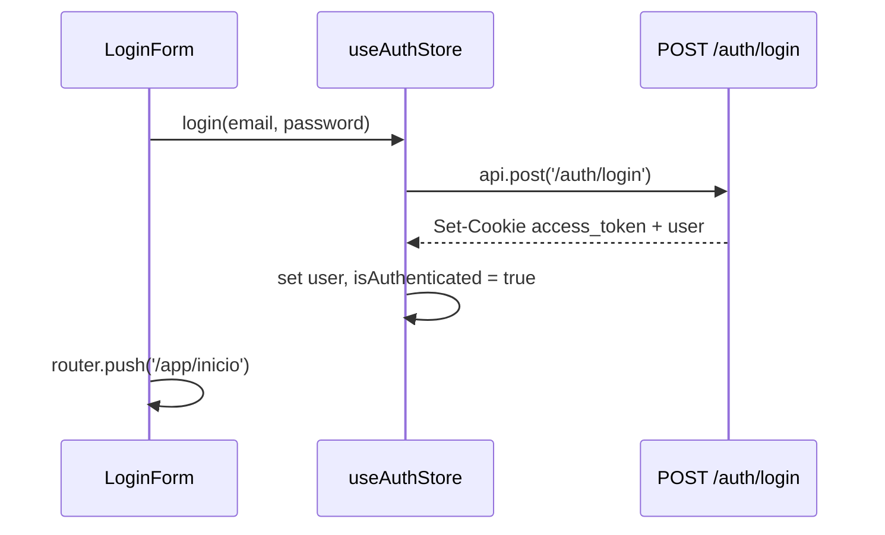

# Autenticación en el frontend

El frontend **no protege rutas**. No hay `middleware.ts` (ni `proxy.ts`, su nombre en Next 16) y
ninguna página consulta `isAuthenticated` para bloquearse. La protección es **reactiva**: la
sesión vive en una cookie httpOnly que el frontend no puede leer, y cuando el backend responde 401
el frontend limpia su estado y manda al login.

:::warning
Cualquiera puede cargar el esqueleto de `/app/...` sin sesión. Lo que no puede es obtener datos:
la primera llamada a la API devuelve 401 y la página redirige al login. Cualquier dato sensible
debe venir del backend, nunca estar escrito en el bundle.
:::

## Piezas

| Pieza            | Archivo                                     | Responsabilidad                                                                                        |
| ---------------- | ------------------------------------------- | ------------------------------------------------------------------------------------------------------ |
| Instancia Axios  | `lib/api.ts`                                | `withCredentials: true` para enviar la cookie; interceptor de respuesta para 401, 429 y errores de red |
| Store de sesión  | `store/auth-store.ts`                       | `login`, `logout` y los datos del usuario para la interfaz                                             |
| Listener         | `components/auth/auth-expired-listener.tsx` | Escucha `auth-expired` y hace `router.push('/login')`                                                  |
| Layout protegido | `app/app/layout.tsx`                        | Monta el listener solo dentro de la aplicación                                                         |

## Login



El token **no se guarda** en el store ni en `localStorage`: viaja solo en la cookie.

## El store (`store/auth-store.ts`)

Zustand con `persist` en `localStorage` bajo la clave `auth-storage`, persistiendo solo lo que
pinta la interfaz:

```ts title="store/auth-store.ts"
partialize: (state) => ({
  user: state.user,               // id, nombreCompleto, email, rol
  isAuthenticated: state.isAuthenticated,
}),
```

- `user.rol` es lo que usan la barra lateral y las páginas para mostrar u ocultar opciones.
- `isAuthenticated` es un indicador para la interfaz. La verdad de la sesión es la cookie.
- `logout()` llama a `POST /auth/logout` (solo el backend puede borrar una cookie httpOnly),
  limpia el store de notificaciones y deja `user` en `null`. Si la llamada falla, limpia igual.

:::info
Como `user` persiste en `localStorage`, tras caducar la cookie la barra lateral sigue mostrando
el nombre y el rol hasta la primera llamada a la API, que devuelve 401 y dispara el logout.
:::

## Flujo del 401

```ts title="lib/api.ts"
api.interceptors.response.use(
  (response) => response,
  (error) => {
    if (error.response?.status === 401) {
      void useAuthStore.getState().logout();
      if (typeof window !== 'undefined') {
        window.dispatchEvent(new Event('auth-expired'));
      }
    }
    // 429: mensaje en español para "demasiadas peticiones"
    // Network Error: mensaje de conexión para el usuario
    return Promise.reject(error);
  }
);
```

```tsx title="components/auth/auth-expired-listener.tsx"
useEffect(() => {
  function handleAuthExpired() {
    router.push('/login');
  }
  window.addEventListener('auth-expired', handleAuthExpired);
  return () => window.removeEventListener('auth-expired', handleAuthExpired);
}, [router]);
```

Se usa un evento del navegador y `router.push` en lugar de `window.location.href` para no recargar
la página completa. `router.push('/login')` respeta el `basePath`.

**Regla:** no repetir la lógica de logout ni de 401 en servicios o componentes. Un servicio deja
que el error se propague; el componente solo muestra el mensaje.

## Rol y permisos en la interfaz

Las páginas leen `useAuthStore().user?.rol` para decidir qué mostrar. Ejemplos:

- `app-sidebar.tsx`: `canViewMonitor` para `ADMIN`, `EJECUTIVO`, `CONTADOR`, `TESORERO`.
- `monitor/page.tsx`, `monitor-rendiciones/page.tsx`: `MONITOR_ALLOWED_ROLES`.
- `usuarios/page.tsx`: solo `ADMIN`.

Todo esto es orientación. Los mismos permisos los impone el backend con `@Roles()` y con las
comprobaciones de propiedad de cada servicio.

## Manual técnico

Este sitio se enlaza desde la aplicación con `MANUAL_TECNICO_URL` (`lib/manual.ts`). La protección
la hace nginx con `auth_request` contra `GET /auth/sesion`, aprovechando que la cookie, con
`path=/amzdesk`, también viaja a `/amzdesk/manual/tecnico/`.
