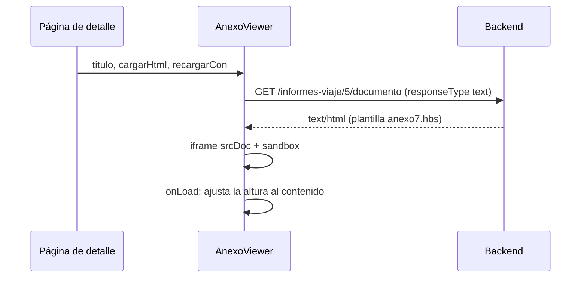

# Documentos en pantalla

El frontend **no reconstruye los anexos**: muestra el HTML que genera el backend con la misma
plantilla Handlebars que usa para el PDF. Así la vista en pantalla y el documento impreso no
pueden diferir.

## Cómo funciona



### `AnexoViewer` (`components/shared/anexo-viewer.tsx`)

- Recibe `cargarHtml(signal)`, una función que trae el HTML, y `recargarCon`, la clave que dispara
  una nueva carga (normalmente el id o el `updatedAt` del documento).
- Pinta el HTML en un `iframe` con `srcDoc`. El aislamiento evita que los estilos de hoja impresa
  del anexo choquen con los de la aplicación, incluido el tema oscuro: el documento siempre se ve
  como papel blanco.
- `sandbox="allow-same-origin"`: **sin scripts**. Solo se permite leer el alto del documento para
  ajustar el `iframe` y que no haya doble barra de desplazamiento.
- `anchoMinimo` (640 px por defecto) fuerza desplazamiento horizontal en pantallas chicas en lugar
  de deformar la hoja.
- Mientras carga muestra `Skeleton`; si falla, sugiere descargar el PDF.
- Cancela la petición con `AbortController` si el componente se desmonta o cambia la clave.

### `DocumentoViewer` (`components/shared/documento-viewer.tsx`)

Envoltorio para el caso común: recibe la `ruta` del endpoint y hace el `api.get` con
`responseType: 'text'`.

```tsx
<DocumentoViewer
  titulo="ANEXO 7 — Informe de Viaje"
  ruta={`/informes-viaje/${id}/documento`}
  recargarCon={informe.updatedAt}
/>
```

Los ANEXOS 1, 2 y 4 tienen visores propios (`components/planes-viaje/anexo1-viewer.tsx`,
`components/solicitudes/anexo2-viewer.tsx` y el detalle de rendición) que usan `AnexoViewer` con la
función del servicio correspondiente.

## Endpoints de HTML

Todos responden `Content-Type: text/html; charset=utf-8` y aplican las mismas reglas de acceso que
el detalle del registro.

| Documento                   | Endpoint HTML                                                               | Endpoint PDF                                              |
| --------------------------- | --------------------------------------------------------------------------- | --------------------------------------------------------- |
| ANEXO 1 Plan de Viaje       | `GET /planes-viaje/:id/anexo1`                                              | `GET /planes-viaje/:id/pdf`                               |
| ANEXO 2 Solicitud de viaje  | `GET /solicitudes/:id/anexo2`                                               | `GET /solicitudes/:id/pdf`                                |
| ANEXO 3 Solicitud de compra | `GET /solicitudes/:id/documento`                                            | `GET /solicitudes/:id/pdf`                                |
| ANEXO 4 Rendición           | `GET /rendiciones/:id/anexo4`                                               | `GET /rendiciones/:id/pdf` y `GET /rendiciones/:id/excel` |
| ANEXO 5 Liquidación         | `GET /liquidaciones-viaticos/:id/documento` y `.../hojas/:hojaId/documento` | equivalentes con `pdf`                                    |
| ANEXO 6 Movilidad           | `GET /declaraciones-movilidad/:id/documento`                                | `GET /declaraciones-movilidad/:id/pdf`                    |
| ANEXO 7 Informe de Viaje    | `GET /informes-viaje/:id/documento`                                         | `GET /informes-viaje/:id/pdf`                             |
| ANEXO 11 Cuadro comparativo | `GET /cuadros-comparativos/:id/documento`                                   | `GET /cuadros-comparativos/:id/pdf`                       |
| ANEXO 12 Orden de compra    | `GET /ordenes-compra/:id/documento`                                         | `GET /ordenes-compra/:id/pdf`                             |
| Cotización                  | `GET /cotizaciones/:id/documento`                                           | `GET /cotizaciones/:id/pdf`                               |

`GET /solicitudes/:id/documento` sirve el ANEXO 2 si la solicitud es de viaje y la plantilla
`solicitud.hbs` si es de compra; `GET /solicitudes/:id/anexo2` responde 400 para una compra.

## Seguridad del HTML

El HTML viene del propio backend y los datos se insertan con `{{variable}}` de Handlebars, que
escapa el contenido. El `sandbox` sin `allow-scripts` es una segunda barrera: aunque se colara un
`script`, no se ejecutaría.

:::warning
No usar `{{{triple}}}` en las plantillas con datos que escribe el usuario: el triple bigote no
escapa y el HTML llegaría tal cual al visor.
:::

## Descargas

Los botones de descarga llaman al servicio (`responseType: 'blob'`) y pasan el resultado a
`downloadBlob()` (`lib/utils/download-blob.ts`), que comprueba el `Content-Type`, crea un enlace
temporal y dispara la descarga con el nombre indicado.
