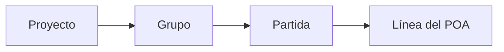

# POA

El **POA** (Plan Operativo Anual) es el presupuesto de ACEAA. Cada solicitud consume una o
varias líneas del POA, y nadie puede gastar más de lo que una línea tiene disponible.

## Cómo está armado

Cada línea del POA cuelga de una estructura de cuatro niveles. Es la misma cascada que ves al
elegir el presupuesto de una solicitud:

Cada línea tiene un código POA, una actividad, una cantidad, un costo unitario y un **costo
total**.

## Comprometido, ejecutado y disponible

| Momento          | Qué pasa                                                                                                                                 |
| ---------------- | ---------------------------------------------------------------------------------------------------------------------------------------- |
| **Comprometido** | Al crear la solicitud, su monto queda reservado contra la línea. Cuentan las solicitudes en `PENDIENTE`, `DESEMBOLSADO` y `EN_EJECUCION` |
| **Ejecutado**    | Al aprobarse la rendición (o al pagarse la última cuota de una consultoría), el gasto real se suma a la línea                            |
| **Disponible**   | Costo total menos ejecutado menos comprometido                                                                                           |

Por ejemplo: si se desembolsaron Bs 1.000 y se rindieron Bs 800, la línea ejecuta 800 y los
200 restantes vuelven a estar disponibles.

:::danger El techo del POA es duro
No se puede crear una solicitud contra una línea sin saldo disponible, y no se puede aprobar
una rendición que haga superar el costo total. Ningún rol puede saltarse este control: si el
POA está mal cargado, se corrige el POA.
:::

## Dónde se ve el POA

No hay una pantalla para consultar el POA completo. Lo ves en partes:

- **Al crear una solicitud**: el selector de presupuesto muestra el saldo de cada línea.
- **En Inicio**, para `ADMIN`, `EJECUTIVO` y `TESORERO`: el indicador **Salud Financiera del
  POA Global**, con **Presupuesto Total**, **Consumido** (comprometido más ejecutado), **Saldo
  Disponible** y el porcentaje consumido.
- **En Monitores > Solicitudes**: el filtro **Filtrar por Partida...** muestra las solicitudes
  de una partida.
- **En la Base Documental**: el documento del POA del año.

## Cómo se carga y se modifica

El POA se carga una sola vez con la carga inicial del sistema. **No hay pantalla para crear,
editar ni bloquear líneas**: cualquier corrección o modificación presupuestaria la hace el
equipo técnico.

Una línea puede estar bloqueada: en ese caso no aparece al elegir el presupuesto de una
solicitud.

:::caution Pendiente de confirmar

- Hoy solo existe un POA a la vez: el sistema no distingue gestiones (2026, 2027). Falta
  definir cómo se cargará el POA del año siguiente sin perder el histórico.
- La modificación presupuestaria aprobada por Dirección Ejecutiva no existe en el sistema.
  :::
