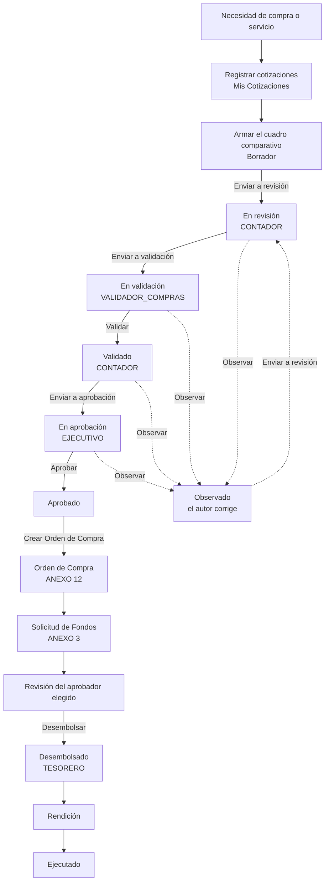

# El flujo de compras de un vistazo

Cuando ACEAA compra un bien o contrata un servicio, el trámite deja un expediente completo:
las cotizaciones de los proveedores, el cuadro que las compara, la orden al proveedor elegido y
la solicitud de fondos para pagarla. En AMZ Desk todo eso vive en **Compras y Servicios**, en
el panel lateral.

| Entrada del menú          | Qué haces ahí                                 | Documento                               |
| ------------------------- | --------------------------------------------- | --------------------------------------- |
| **Mis Cotizaciones**      | Registras la cotización de cada proveedor     | Formulario de Solicitud de Cotizaciones |
| **Cuadros Comparativos**  | Comparas las cotizaciones y propones la mejor | ANEXO 11                                |
| **Órdenes de Compra**     | Emites la orden al proveedor elegido          | ANEXO 12                                |
| **Solicitudes de Fondos** | Pides el dinero para pagar                    | ANEXO 3                                 |

## El recorrido completo

## Quién hace qué

| Paso                                              | Quién                                       | Página                                                     |
| ------------------------------------------------- | ------------------------------------------- | ---------------------------------------------------------- |
| Registrar las cotizaciones                        | Quien necesita la compra                    | [Cotizaciones](./cotizaciones.md)                          |
| Armar el cuadro comparativo y enviarlo a revisión | Quien necesita la compra                    | [Cuadro comparativo](./cuadro-comparativo.md)              |
| Revisar el cuadro y enviarlo a validación         | Contabilidad (`CONTADOR`)                   | [Revisión y validación](./revision-validacion.md)          |
| Validar el cuadro                                 | Adquisiciones (`VALIDADOR_COMPRAS`)         | [Revisión y validación](./revision-validacion.md)          |
| Enviar a aprobación y aprobar                     | Contabilidad, luego Dirección (`EJECUTIVO`) | [Aprobación](./aprobacion.md)                              |
| Emitir la orden de compra                         | Quien necesita la compra                    | [Orden de compra](./orden-compra.md)                       |
| Pedir los fondos                                  | Quien necesita la compra                    | [Solicitud de fondos](./solicitud-fondos.md)               |
| Desembolsar                                       | Dirección Financiera (`TESORERO`)           | [Solicitud de fondos](./solicitud-fondos.md)               |
| Pagar un contrato de consultoría por cuotas       | Adquisiciones, el aprobador y Tesorería     | [Consultorías: cronograma de pagos](./cronograma-pagos.md) |

## Reglas que conviene saber antes de empezar

- **Un cuadro comparativo necesita al menos dos cotizaciones.** Si un proveedor no está
  registrado, puedes agregarlo como cotización externa desde el mismo cuadro.
- **Observar no es rechazar.** Un cuadro observado vuelve a su autor, que lo corrige y lo envía
  de nuevo. Solo se puede editar en **Borrador** u **Observado**.
- **La revisión va antes que la validación.** Contabilidad recibe el cuadro primero, lo pasa a
  Adquisiciones para validar, y vuelve a Contabilidad para enviarlo a aprobación.
- **El presupuesto es un límite duro.** La solicitud de fondos se imputa a una partida del POA
  y no se puede registrar si la partida no tiene saldo.
- **Hoy la solicitud de fondos no se vincula con el cuadro ni con la orden.** Son trámites
  separados: la solicitud no muestra qué orden paga. Anota el código de la orden en las
  observaciones de la solicitud para que el expediente se pueda seguir.

:::info Compras sin cuadro comparativo
Algunas compras no requieren cuadro ni orden: las de caja chica y los gastos exentos que lista
el _Manual de Procedimientos Administrativos_ (parqueos, exceso de equipaje, cambio de pasajes,
gasolina, licencias, gastos amparados por convenio). En esos casos ve directo a la
[Solicitud de fondos](./solicitud-fondos.md). El sistema no comprueba qué respaldos exige cada
monto: esa verificación queda en manos de quien revisa.
:::
