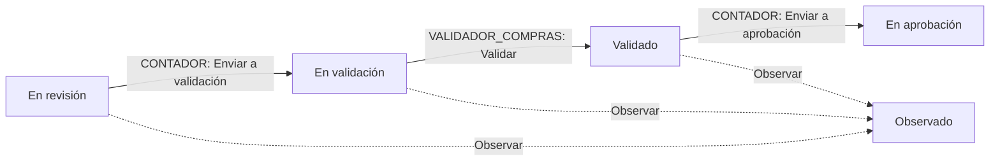

# Revisión y validación del cuadro

Antes de llegar a Dirección, el cuadro comparativo pasa por dos manos: **Contabilidad** lo
revisa y **Adquisiciones** valida las cotizaciones. Después vuelve a Contabilidad, que lo eleva
a aprobación.

**Quién lo hace:**

- Revisión: el `CONTADOR`.
- Validación: el `VALIDADOR_COMPRAS` (Responsable de Adquisiciones y Logística).
- `ADMIN` puede hacer cualquiera de los dos pasos si la persona titular no está.

:::caution El orden es contraintuitivo
**Primero revisa Contabilidad, después valida Adquisiciones.** El estado que deja la
validación se llama **Validado** en pantalla (internamente `REVISADO`): no lo confundas con la
revisión de Contabilidad.
:::

## Paso 1: revisión de Contabilidad

1. Llega la notificación **Cuadro por revisar** (a todas las cuentas `CONTADOR`). Púlsala, o
   abre **Compras y Servicios**, luego **Cuadros Comparativos**: verás los que están **En
   revisión**.
2. Abre el cuadro con **Ver detalle**.
3. Revisa la vista previa del ANEXO 11, la **Recomendación del sistema** y la **Comparación de
   totales**. Abre las cotizaciones externas con **Ver documento** si necesitas el original.
4. Decide:
   - Si está bien, pulsa **Enviar a validación**. El cuadro pasa a **En validación** y
     Adquisiciones recibe **Cuadro por validar**.
   - Si hay que corregir, pulsa **Observar** (ver más abajo).

## Paso 2: validación de Adquisiciones

1. Llega la notificación **Cuadro por validar**. En **Cuadros Comparativos** verás los que
   están **En validación**.
2. Abre el cuadro con **Ver detalle**.
3. Verifica que las cotizaciones sean válidas: proveedores reales, precios bien transcritos,
   ítems comparables, cantidad de cotizaciones suficiente para el monto.
4. Decide:
   - Si está bien, pulsa **Validar**. El cuadro pasa a **Validado** y Contabilidad recibe de
     nuevo **Cuadro por revisar**, con el mensaje de que fue validado.
   - Si hay que corregir, pulsa **Observar**.

## Paso 3: Contabilidad lo eleva

Con el cuadro en **Validado**, el `CONTADOR` lo abre y pulsa **Enviar a aprobación** (o
**Observar**). Lo que sigue está en [Aprobación](./aprobacion.md).

## Observar un cuadro

1. Pulsa **Observar**. Se abre la ventana **Observar cuadro comparativo**.
2. Escribe el **Motivo de la observación**: qué debe corregir el autor. Es obligatorio.
3. Pulsa **Observar** en la ventana.
4. El cuadro pasa a **Observado**, el autor recibe **Cuadro observado** con tu motivo y el
   cuadro sale de tu lista.

Cuando el autor lo corrige y lo envía de nuevo, vuelve a **En revisión**: el recorrido empieza
otra vez por Contabilidad.

## Qué ve cada uno

- El `CONTADOR` ve en su lista los cuadros **En revisión** y **Validado**, además de los
  propios. No ve los que están en validación o aprobación.
- El `VALIDADOR_COMPRAS` ve solo los cuadros **En validación**, además de los propios.
- Ninguno de los dos puede editar el cuadro: si algo está mal, se observa.

:::tip Motivos claros
Escribe el motivo como una instrucción concreta ("Falta la tercera cotización; el monto supera
el umbral de 500 USD") y no como un juicio. El autor solo ve ese texto para corregir.
:::
