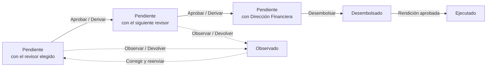

# Solicitud de fondos (ANEXO 3)

La solicitud de fondos de compras y servicios pide el dinero para pagar una compra o un
servicio, con cargo a una partida del POA. Es el ANEXO 3 (Solicitud de Fondos en Avance).
Recorre el mismo circuito que una solicitud de viaje: la revisa la persona que eliges, la
desembolsa Dirección Financiera y después se rinde.

**Quién lo hace:** quien necesita la compra (cualquier rol).

:::info Los contratos de consultoría son distintos
Si la partida elegida es de consultoría, el formulario cambia a **Contrato de Consultoría** y el
contrato se paga por cuotas, sin pasar por este circuito de aprobación. Ver
[Consultorías: cronograma de pagos](./cronograma-pagos.md).
:::

## Crear la solicitud

1. En el panel lateral, abre **Compras y Servicios** y luego **Solicitudes de Fondos**.
2. Pulsa **Nueva Solicitud**. Se abre **Nueva Solicitud de Fondos**.
3. **Información General de la Solicitud**: escribe el **MOTIVO DE SOLICITUD** (por ejemplo
   "TALLER POA 2026").
4. **Partida Presupuestaria**, en **Configuración Global de Presupuesto**:
   1. **Código POA**: búscalo y selecciónalo.
   2. **Proyecto**, **Grupo** y **Partida**, en ese orden.
   3. En **Seleccionar Ítem / Actividad de Presupuesto**, elige la tarjeta de la actividad. Si
      te equivocas, pulsa **Cambiar selección**.
5. **Descripción del Gasto**: carga cada ítem con **Cantidad**, **Descripción**, **Uso**
   (**Oficina** o **Campo**) y **P/Unit. (Bs)**. El **Total (Bs)** se calcula solo. Usa
   **Agregar ítem** para sumar filas.
6. **Observaciones**: agrega lo que ayude a quien revisa. Anota aquí el código de la orden de
   compra o del cuadro comparativo que respalda la compra.
7. Revisa el **Total Solicitado** al pie y pulsa **Revisar y Enviar**.

## Revisar y enviar

Se abre la ventana **Revisar y Enviar Solicitud**:

1. En **Datos de la Solicitud**, completa **Cheque a nombre de** (obligatorio): el nombre
   completo del beneficiario del pago.
2. Revisa la **Partida Presupuestaria**: **Código POA**, **Actividad**, **Código** y **Saldo
   disponible**.
3. Revisa la tabla **Descripción del Gasto**.
4. En **Enviar solicitud a:**, pulsa **Seleccionar responsable...** y elige a tu inmediato
   superior o al coordinador del área. Es obligatorio.
5. Pulsa **Confirmar Envío**. Si necesitas cambiar algo, **Volver a editar**.

La solicitud queda **Pendiente**, con un código del tipo `SOL-2026-001`, y la persona elegida
recibe la notificación **Asignada**.

:::danger Saldo del POA
Si el total supera el saldo disponible de la partida, el sistema rechaza la solicitud con
**Saldo insuficiente en el POA especificado**. No hay forma de saltar este control: habla con
quien administra el POA.
:::

## Revisión y desembolso

**Quien revisa** (la persona elegida):

1. Pulsa la notificación **Asignada**, o abre **Notificaciones**. Se abre el detalle de la
   solicitud con su código y estado.
2. Revisa el documento y decide:
   - **Aprobar / Derivar**: en **Derivar Solicitud**, elige en **Seleccionar aprobador...** a
     la siguiente persona y pulsa **Confirmar Derivación**. Para que se pague, la solicitud
     debe llegar a Dirección Financiera (`TESORERO`).
   - **Observar / Devolver**: en **Observar Solicitud**, explica el motivo y pulsa **Enviar
     Observación**. La solicitud vuelve al emisor.

**Dirección Financiera** (`TESORERO`), cuando la solicitud le llega:

1. Abre la solicitud desde la notificación y pulsa **Desembolsar**.
2. En **Desembolsar Solicitud**, completa el **Código de Transferencia / Comprobante** (por
   ejemplo `TRF-2026-00123`) y la **URL del Comprobante**, el enlace al comprobante de la
   transferencia. Los dos son obligatorios.
3. Pulsa **Confirmar Desembolso**. La solicitud pasa a **Desembolsado** y el emisor recibe la
   notificación **Aprobada**.

## Estados

| Estado           | Qué significa                                                                           | Quién actúa                                      |
| ---------------- | --------------------------------------------------------------------------------------- | ------------------------------------------------ |
| **Pendiente**    | Enviada; está con un revisor o con Dirección Financiera. Reserva el monto en la partida | El revisor asignado                              |
| **Observado**    | Devuelta al emisor con observaciones                                                    | El emisor: corregir y reenviar                   |
| **Desembolsado** | Dirección Financiera liberó los fondos                                                  | El emisor: rendir                                |
| **En ejecución** | Solo contratos de consultoría: se paga por cuotas                                       | Ver [cronograma de pagos](./cronograma-pagos.md) |
| **Ejecutado**    | Rendición aprobada o última cuota pagada; trámite cerrado                               | Nadie                                            |

No existe un estado "Aprobado": mientras la solicitud recorre a sus revisores, sigue
**Pendiente**.

## Si te la observan

1. Recibes la notificación **Observada** con el motivo. Al pulsarla se abre directamente el
   formulario de corrección.
2. También puedes llegar desde **Solicitudes de Fondos**: en **Acciones** de la fila aparece
   **Editar** solo cuando la solicitud está **Observado**.
3. Corrige, pulsa **Revisar y Enviar**, elige de nuevo a quién enviarla y confirma.
4. La solicitud vuelve a **Pendiente** y el revisor recibe el aviso de la solicitud corregida.

## La lista Solicitudes de Fondos

Muestra **Código**, **Fecha**, **Motivo**, **Estado**, **Cód. Desembolso** (cuando ya está
desembolsada) y **Total (Bs)**. Desde **Acciones**: **Ver detalle**, **Editar** (si está
observada), **Descargar PDF** y **Eliminar**.

El detalle, **Detalle de Solicitud de Fondos**, muestra la vista previa **Anexo 3 — Solicitud
de Fondos en Avance**, la **Descripción adicional**, los **Datos del Desembolso** (**Cheque #**,
**Banco**, **Fecha de emisión**, **Ver comprobante**) y el **Historial de aprobaciones**.

:::caution Pendiente de confirmar
**Eliminar** en la lista muestra el aviso "Eliminar desde el detalle de la solicitud." y no
borra nada, pero el detalle no tiene botón para eliminar. Falta confirmar cómo debe eliminarse
una solicitud de compras que todavía no se desembolsó.
:::

## El documento impreso (ANEXO 3)

- Encabezado con el logo de ACEAA a la izquierda, el de AMZ Desk a la derecha, **ANEXO 3**, el
  título **Solicitud de Fondos — Compras y Servicios**, la nota **(Expresado en Bolivianos)** y
  el código de la solicitud.
- **Datos generales**: **Fecha de solicitud**, **Emisor** y su **Cargo**, **Aprobador**,
  **Proyecto**, **Motivo**, **Código de actividad**, **Cheque a nombre de** y **Cuenta
  bancaria** del proyecto.
- **Resumen financiero**: **TOTAL PRESUPUESTADO** y **TOTAL NETO SOLICITADO**.
- **Datos del desembolso**, cuando ya se desembolsó: código, banco, fecha y comprobante.
- **Detalle de la solicitud**: **TIPO** (Compra, con el uso), **DESCRIPCIÓN**, **CANTIDAD** y
  **MONTO NETO**.
- **Cronograma de pagos**, solo en contratos de consultoría.
- Tres firmas, con nombre y cargo: **Emitido por** (el emisor), **Director del proyecto**
  (quien envió la solicitud a Dirección Financiera) y **Aprobado por** (el Director Ejecutivo).

## Consejos

- Elige bien la partida: el monto queda reservado en ella mientras la solicitud está
  **Pendiente** o **Desembolsado**, y se libera lo que no se gaste al aprobar la rendición.
- La solicitud no se vincula todavía con el cuadro comparativo ni con la orden de compra.
  Escribe sus códigos en **Observaciones** para que el revisor y el auditor puedan seguir el
  expediente.
- Después del desembolso, rinde la compra adjuntando como respaldo la cotización, el cuadro
  comparativo, la orden de compra con la conformidad de recepción y la factura o recibo.
