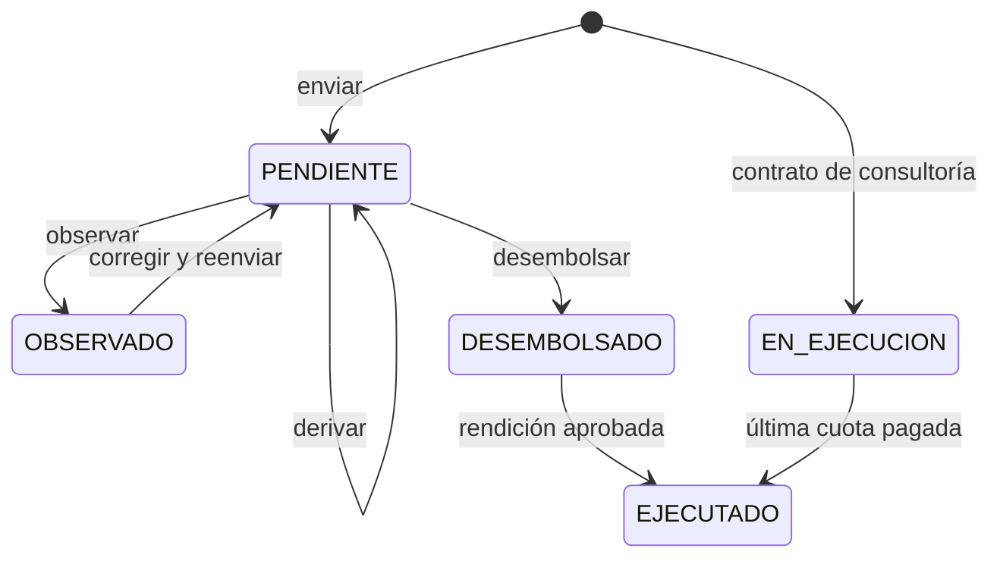
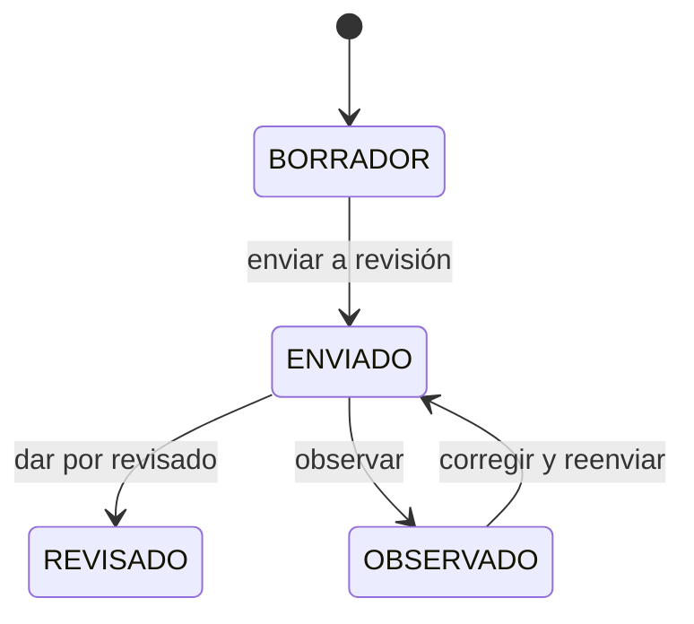
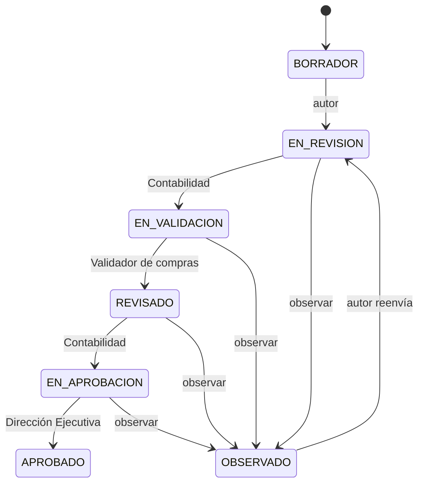

# Estados

Cada documento de AMZ Desk avanza por estados. Esta página dice, para cada documento, qué
significa cada estado y quién lo mueve.

Dos reglas valen para todos:

- **Observar no es rechazar.** Un documento observado vuelve a su autor para que lo corrija y
  lo reenvíe. No muere: regresa al flujo.
- **Solo se edita lo que está en borrador u observado.** Lo demás se ve, pero no se cambia.

## Solicitud (viaje o compra)

En las listas y en el detalle, la solicitud muestra el estado tal cual: `PENDIENTE`,
`OBSERVADO`, etc.

| Estado         | Qué significa para ti                                                                                                                                          | Quién la mueve a este estado                                                                    |
| -------------- | -------------------------------------------------------------------------------------------------------------------------------------------------------------- | ----------------------------------------------------------------------------------------------- |
| `PENDIENTE`    | Está en revisión, en la bandeja de alguien: el Director de Programa, el aprobador que elegiste o Dirección Financiera. Su monto ya está comprometido en el POA | El emisor, al enviarla o al reenviarla corregida                                                |
| `OBSERVADO`    | Te la devolvieron con un motivo. Es el único estado en que puedes editarla                                                                                     | Quien la tenía en su bandeja, con **Observar / Devolver**                                       |
| `DESEMBOLSADO` | Los fondos se entregaron. Ya no se puede eliminar. Toca hacer el viaje o la compra y rendir                                                                    | Dirección Financiera, con **Desembolsar**                                                       |
| `EN_EJECUCION` | Contrato de consultoría vigente: se paga por cuotas. Compromete presupuesto hasta la última cuota                                                              | El emisor, al registrar el contrato (nace en este estado)                                       |
| `EJECUTADO`    | Cerrada. Lo gastado se sumó a lo ejecutado del POA                                                                                                             | Contabilidad, al aprobar la rendición; o Tesorería, al pagar la última cuota de una consultoría |

:::info No existe "aprobada"
La solicitud no tiene un estado `APROBADO`. Mientras pasa del Director de Programa a Dirección
Financiera sigue en `PENDIENTE`; lo que cambia es quién la tiene. Para saber quién, mira la
columna **Aprobador** del monitor o el [Centro de Auditoría](../administracion/centro-de-auditoria.md).
:::

:::caution Pendiente de confirmar
Una solicitud ya desembolsada que se cancela (por ejemplo, un viaje suspendido) no tiene
salida en el sistema: no existe un estado de anulación.
:::

### Cuotas de un contrato de consultoría

Cada cuota del **Cronograma de Pagos** tiene su propio estado:

| Estado          | Qué significa                                                | Quién lo mueve                             |
| --------------- | ------------------------------------------------------------ | ------------------------------------------ |
| **Planificado** | La cuota está en el cronograma, sin pedir                    | El emisor, al registrar el contrato        |
| **Solicitado**  | Adquisiciones pidió el pago con el comprobante del consultor | Quien pulsa **Solicitar pago**             |
| **Observado**   | El aprobador devolvió la cuota con un motivo                 | El aprobador de la cuota, con **Observar** |
| **Aprobado**    | Lista para que Tesorería pague                               | El aprobador de la cuota, con **Aprobar**  |
| **Pagado**      | Pagada. Si es la última, el contrato pasa a `EJECUTADO`      | Tesorería, con **Registrar pago**          |

## Rendición

La rendición también muestra el estado tal cual.

| Estado      | Qué significa para ti                                                                | Quién la mueve                                           |
| ----------- | ------------------------------------------------------------------------------------ | -------------------------------------------------------- |
| `PENDIENTE` | Enviada y en revisión. Sigue en `PENDIENTE` mientras se deriva de una persona a otra | El emisor al enviarla; cada revisor al derivarla         |
| `OBSERVADO` | Te la devolvieron. Corrígela y reenvíala                                             | Quien la revisa, con **Observar / Devolver**             |
| `APROBADO`  | Cerrada. La solicitud pasa a `EJECUTADO`                                             | Solo Contabilidad, con **Aprobar y Finalizar Rendición** |
| `RECHAZADO` | Rechazo definitivo                                                                   | Ver la nota                                              |

:::caution Pendiente de confirmar
El estado `RECHAZADO` existe, pero hoy ninguna pantalla permite rechazar una rendición: en la
práctica solo se aprueba u observa.
:::

## Plan de Viaje (ANEXO 1)

El plan de viaje **no tiene estado ni flujo de aprobación**: el visto bueno lo firma en papel el
Director Ejecutivo. La lista muestra en cambio su situación:

| Situación         | Qué significa                                                                                               |
| ----------------- | ----------------------------------------------------------------------------------------------------------- |
| **Incompleto**    | A alguna actividad le falta la salida, la llegada o el personal declarado. No puede respaldar una solicitud |
| **Disponible**    | Completo y libre: puede respaldar una solicitud de viaje                                                    |
| **Con solicitud** | Ya respalda una solicitud. Solo se puede corregir si esa solicitud está `OBSERVADO`                         |

## Informe de Viaje (ANEXO 7)

| Estado      | Etiqueta        | Qué significa                                                   | Quién lo mueve                                    |
| ----------- | --------------- | --------------------------------------------------------------- | ------------------------------------------------- |
| `BORRADOR`  | **Borrador**    | Lo estás llenando. Se puede editar y eliminar                   | El autor, al crearlo                              |
| `ENVIADO`   | **Por revisar** | Espera la revisión del Director de Programa. No se puede editar | El autor, con **Enviar a revisión**               |
| `OBSERVADO` | **Observado**   | Te lo devolvieron. Corrígelo y reenvíalo                        | El Director de Programa, con **Observar**         |
| `REVISADO`  | **Revisado**    | Aprobado. Ya no se puede eliminar                               | El Director de Programa, con **Dar por revisado** |

## Liquidación de Viáticos (ANEXO 5)

| Estado      | Etiqueta        | Qué significa                                                                             | Quién lo mueve                                    |
| ----------- | --------------- | ----------------------------------------------------------------------------------------- | ------------------------------------------------- |
| `BORRADOR`  | **Borrador**    | La estás llenando. Se puede editar y eliminar                                             | El autor, al crearla                              |
| `ENVIADO`   | **Por revisar** | Espera la revisión del Director de Programa. No se puede editar                           | El autor, con **Enviar a revisión**               |
| `OBSERVADO` | **Observada**   | Te la devolvieron. Corrígela y reenvíala                                                  | El Director de Programa, con **Observar**         |
| `REVISADO`  | **Revisada**    | Aprobada. Ya se puede importar a la rendición como gastos `LV`, y ya no se puede eliminar | El Director de Programa, con **Dar por revisada** |

## Declaración Jurada de Movilidad (ANEXO 6)

**No tiene estado ni revisión en el sistema.** Su autor la crea, la edita y descarga el PDF
para firmarlo. Se adjunta a la rendición.

## Cotización

**No tiene estado.** Puede ser **Cotización Propia** (cargada ítem por ítem) o **Cotización
Externa** (el documento del proveedor, enlazado). En la lista, las externas llevan la etiqueta
**Externa**.

## Cuadro comparativo (ANEXO 11)

| Estado          | Etiqueta en la lista | Qué significa                                                             | Quién lo mueve                                  |
| --------------- | -------------------- | ------------------------------------------------------------------------- | ----------------------------------------------- |
| `BORRADOR`      | **Borrador**         | Lo estás armando. Editable                                                | El autor, al crearlo                            |
| `EN_REVISION`   | **En revisión**      | Espera a Contabilidad                                                     | El autor, con **Enviar a revisión**             |
| `EN_VALIDACION` | **En validación**    | Espera al Validador de compras                                            | Contabilidad, con **Enviar a validación**       |
| `REVISADO`      | **Validado**         | Validado; vuelve a Contabilidad                                           | El Validador de compras, con **Validar**        |
| `EN_APROBACION` | **En aprobación**    | Espera a Dirección Ejecutiva                                              | Contabilidad, con **Enviar a aprobación**       |
| `APROBADO`      | **Aprobado**         | Listo para **Crear Orden de Compra**                                      | Dirección Ejecutiva, con **Aprobar**            |
| `OBSERVADO`     | **Observado**        | Te lo devolvieron. Editable; al corregirlo vuelve a **Enviar a revisión** | Quien lo tenía en ese momento, con **Observar** |

En la pantalla de detalle, la etiqueta agrega quién tiene el cuadro, por ejemplo "En revisión
(Contador)".

:::warning Ojo con el orden
La revisión de Contabilidad va **antes** que la validación, y `REVISADO` (**Validado**) es el
estado que deja el Validador de compras, no Contabilidad.
:::

## Orden de compra (ANEXO 12)

**No tiene estado.** Se emite desde un cuadro comparativo **Aprobado** con **Crear Orden de
Compra**, que precarga el proveedor recomendado y sus ítems. Su autor puede editarla o
eliminarla.

## Línea del POA

| Estado      | Qué significa                          |
| ----------- | -------------------------------------- |
| `ACTIVO`    | Se puede elegir al armar una solicitud |
| `BLOQUEADO` | No aparece al elegir el presupuesto    |
