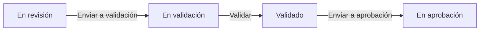

# Contabilidad

Contabilidad (rol `CONTADOR`) tiene dos tareas en AMZ Desk: **cerrar las rendiciones** y
**revisar los cuadros comparativos** de compras antes y después de su validación.

## Qué llega a tu bandeja

| Etiqueta en **Notificaciones** | Qué es                                                                                                                       |
| ------------------------------ | ---------------------------------------------------------------------------------------------------------------------------- |
| **Rendición pendiente**        | Una rendición que te derivaron para el cierre                                                                                |
| **Cuadro por revisar**         | Un cuadro comparativo que su autor envió a revisión, o uno que el Validador de compras ya validó y debes enviar a aprobación |

En **Compras y Servicios > Cuadros Comparativos** ves, además de los tuyos, todos los cuadros
**En revisión** y **Validado**: los que esperan una acción tuya.

## Cerrar una rendición

Solo el rol `CONTADOR` puede aprobar una rendición de forma definitiva. Quien la revisa antes
(el responsable del área, Dirección Financiera) solo puede derivarla.

1. Abre la notificación **Rendición pendiente**.
2. Revisa el ANEXO 4, la solicitud de origen, los gastos y los resúmenes **Resumen de Partidas
   Contables** y **Resumen de Partidas Presupuestarias**.
3. Marca cada gasto: **un clic** lo marca como correcto; **doble clic** lo marca como
   observado y abre un campo para la observación.
4. Decide:
   - **Aprobar y Finalizar Rendición**: solo se activa cuando todos los gastos están marcados
     como correctos. Puedes dejar un comentario opcional y pulsar **Confirmar**.
   - **Observar / Devolver**: el comentario se llena con lo que marcaste en los gastos. Pulsa
     **Enviar Observación** y la rendición vuelve al emisor.

Al aprobar:

- La rendición pasa a `APROBADO` y la solicitud a `EJECUTADO`.
- Lo rendido se suma a lo ejecutado de cada partida del POA. Lo que no se gastó deja de estar
  comprometido y vuelve a estar disponible.

:::danger La aprobación es definitiva
No hay forma de deshacer una rendición aprobada desde la aplicación. Revisa antes de
confirmar.
:::

:::info Partidas de los gastos
La partida contable y la partida presupuestaria de cada gasto las ajusta quien revisa antes
que tú. En la pantalla de Contabilidad esos campos se ven, pero no se editan. Si hay una
partida mal asignada, observa la rendición.
:::

### Antes de aprobar, verifica

- [ ] Cada gasto tiene su comprobante y el enlace abre.
- [ ] El tipo de documento de cada gasto (`FACTURA`, `RECIBO`, `LV`, `PAT`…) es el correcto:
      de él depende la retención. Ver [Impuestos y retenciones](../referencia/impuestos-y-retenciones.md).
- [ ] Las retenciones calculadas son coherentes con el tipo de documento y el tipo de gasto.
- [ ] Cada gasto está en la partida contable y en la partida presupuestaria correctas.
- [ ] El saldo del ANEXO 4 (lo recibido menos lo gastado) es correcto, y si hay saldo a
      devolver, que se haya depositado. El sistema calcula el saldo pero no registra la
      devolución: ese control es tuyo.
- [ ] En un viaje, la liquidación de viáticos está revisada e importada como gastos `LV`, y el
      aviso del Informe de Viaje no indica que falte. (El sistema no bloquea si falta el informe.)

Si al aprobar aparece "La aprobación excede el presupuesto del POA...", lo rendido supera lo
que queda del costo total de una partida. La rendición no se aprueba hasta corregir los montos
o el POA.

## Revisar un cuadro comparativo

En el flujo de compras intervienes dos veces: **antes** y **después** de la validación.

1. Abre el cuadro desde la notificación **Cuadro por revisar** o desde la lista.
2. Revisa el ANEXO 11, la **Comparación de totales** y el historial.
3. Según el estado:
   - **En revisión**: pulsa **Enviar a validación**. El Validador de compras recibe el aviso.
   - **Validado**: pulsa **Enviar a aprobación**. Dirección Ejecutiva recibe el aviso.
   - En los dos estados puedes pulsar **Observar**, escribir el motivo y confirmar. El cuadro
     vuelve a su autor en estado **Observado**.

### Antes de enviar a validación, verifica

- [ ] El cuadro tiene las cotizaciones que exige el monto (tres desde USD 501, según el
      manual de procedimientos).
- [ ] Los ítems y las cantidades coinciden entre cotizaciones.
- [ ] Hay una cotización recomendada y la elección está justificada.

### Antes de enviar a aprobación, verifica

- [ ] El historial muestra la validación del Validador de compras.
- [ ] Nada cambió en el cuadro desde tu primera revisión.

## Pantallas que usas

| Pantalla               | Ruta en el panel lateral                       |
| ---------------------- | ---------------------------------------------- |
| Bandeja de Entrada     | **Notificaciones**                             |
| Cuadros comparativos   | **Compras y Servicios > Cuadros Comparativos** |
| Monitor de Rendiciones | **Monitores > Rendiciones**                    |
| Monitor de Solicitudes | **Monitores > Solicitudes**                    |
| Centro de Auditoria    | **Centro de Auditoria**                        |

:::caution Pendiente de confirmar
El panel lateral de Contabilidad muestra **Analítica**, pero el servidor solo la permite a
`ADMIN`, `EJECUTIVO` y `TESORERO`: al abrirla verás **Acceso Denegado**.
:::
