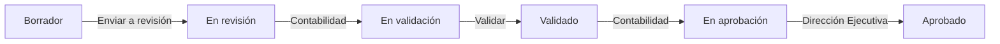

# Validador de compras

El Validador de compras (rol `VALIDADOR_COMPRAS`) es el responsable de Adquisiciones. Valida
las cotizaciones de cada cuadro comparativo: que los proveedores, los precios y la cotización
recomendada sean correctos.

## Dónde estás en el flujo de compras

La validación ocurre **después** de la primera revisión de Contabilidad, no antes:

## Qué llega a tu bandeja

| Etiqueta en **Notificaciones** | Qué es                                    |
| ------------------------------ | ----------------------------------------- |
| **Cuadro por validar**         | Contabilidad envió un cuadro a validación |

En **Compras y Servicios > Cuadros Comparativos** ves tus propios cuadros y todos los que
están **En validación**.

## Validar un cuadro comparativo

1. Abre la notificación **Cuadro por validar** o el cuadro desde la lista.
2. Revisa el **Anexo 11 — Cuadro Comparativo de Cotizaciones**, la **Comparación de totales**
   y el historial.
3. Decide:
   - **Validar**: el cuadro pasa a **Validado** y vuelve a Contabilidad para que lo envíe a
     aprobación.
   - **Observar**: escribe el motivo en la ventana **Observar cuadro comparativo** y confirma
     con **Observar**. El cuadro vuelve a su autor en estado **Observado**.

Solo puedes validar u observar un cuadro mientras está **En validación**. En los demás estados
lo ves, pero sin botones de acción.

### Antes de validar, verifica

- [ ] Cada cotización es de un proveedor real y su respaldo (cotización externa) abre.
- [ ] El número de cotizaciones corresponde al monto de la compra (tres desde USD 501, según
      el manual de procedimientos).
- [ ] Todas las cotizaciones cotizan los mismos ítems y cantidades.
- [ ] Los precios unitarios y los totales están bien transcritos.
- [ ] La cotización recomendada es la más conveniente, o la justificación explica por qué no.
- [ ] Garantía, disponibilidad y si el proveedor emite factura están completos.

:::info El sistema no valida los umbrales
AMZ Desk no calcula el tramo de la compra ni avisa si faltan cotizaciones. Ese control es
tuyo.
:::

## Pagos de contratos de consultoría

Las cuotas de un contrato de consultoría las solicita Adquisiciones desde el detalle del
contrato (**Compras y Servicios > Solicitudes de Fondos**), tarjeta **Cronograma de Pagos**:

1. En la cuota **Planificado**, pulsa **Solicitar pago**.
2. Completa **Comprobante del consultor** (la factura o el recibo, obligatorio), **Informe o
   producto entregado** (opcional) y la persona que debe aprobar el pago.
3. Si la cuota vuelve **Observado**, pulsa **Corregir y reenviar**: verás el motivo de la
   devolución.

No puedes elegirte a ti mismo como aprobador de un pago.

## Pantallas que usas

| Pantalla                          | Ruta en el panel lateral                        |
| --------------------------------- | ----------------------------------------------- |
| Bandeja de Entrada                | **Notificaciones**                              |
| Cuadros comparativos              | **Compras y Servicios > Cuadros Comparativos**  |
| Solicitudes de compra y contratos | **Compras y Servicios > Solicitudes de Fondos** |

Tu rol no ve **Monitores**, **Analítica** ni **Centro de Auditoria**.

:::caution Pendiente de confirmar
El panel lateral te muestra **Viajes y Viáticos > Mis Rendiciones**, pero el servidor no
permite las rendiciones al rol `VALIDADOR_COMPRAS`: la pantalla no carga. Si necesitas rendir
un viaje propio, consulta al administrador del sistema.
:::
