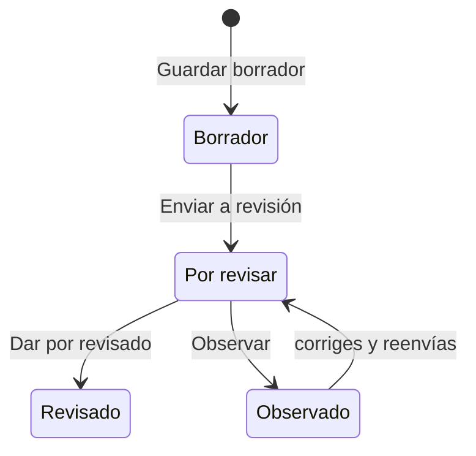

# Informe de Viaje (ANEXO 7)

El informe de viaje cuenta lo que se hizo realmente en el viaje: día por día, dónde, con quién y
qué actividades se realizaron. Es el respaldo técnico de la rendición.

- **Quién lo hace:** quien hizo la solicitud, sobre una solicitud de viaje propia ya
  desembolsada. Cada solicitud tiene un solo informe.
- **Quién lo revisa:** el **Director de Programa** que eliges; se propone el de la solicitud.

## Crear el informe

1. En el menú lateral, abre **Viajes y Viáticos** y elige **Informe de Viaje**.
2. Pulsa **Nuevo informe de viaje**. También puedes llegar con **Crear informe de viaje** desde
   el aviso de la rendición.
3. En **¿De qué viaje informas?**, elige la solicitud. Motivo, lugar, fechas y actividades se
   toman del plan de viaje; luego completas lo que realmente se hizo.
4. Revisa la cabecera:
   - **A:** el Director Ejecutivo. No se puede cambiar.
   - **De:** tú.
   - **Motivo del viaje** y **Lugar de viaje**.
   - **Fecha:** se calcula de las fechas de la tabla.
5. En la tabla **Informe**, ajusta cada fila a lo que pasó de verdad:
   - **Fecha**, **Lugar**, **Persona / institución / lugar** y **Actividades realizadas**.
   - Usa **Agregar fila**, **Quitar fila**, **Subir fila** y **Bajar fila** para ordenarla.
6. Al pie, completa **Lugar de emisión**, **Fecha** y **Director de Programa que revisa**.
   No puedes elegirte a ti ni a Dirección Financiera.
7. Pulsa **Guardar borrador** para seguir después, o **Guardar y enviar a revisión**.

Para enviarlo a revisión el informe debe tener al menos una actividad.

:::tip El informe detallado va aparte
El formulario lo recuerda: el informe detallado se hace llegar al Coordinador de Proyectos o al
Director de Sede, según corresponda. El ANEXO 7 es el resumen.
:::

## Los estados del informe

| Estado          | Qué significa para ti                                                        |
| --------------- | ---------------------------------------------------------------------------- |
| **Borrador**    | Lo estás preparando. Puedes editarlo o eliminarlo.                           |
| **Por revisar** | Lo enviaste; espera al Director de Programa. No puedes editarlo.             |
| **Observado**   | El Director de Programa te lo devolvió con un motivo. Corrígelo y reenvíalo. |
| **Revisado**    | Listo. Respalda la rendición y ya no se puede eliminar.                      |

## Enviar a revisión

Si guardaste un borrador, ábrelo desde el listado y pulsa **Enviar a revisión**. Mientras
espera, el detalle muestra "El informe está esperando la revisión de" y el nombre del director.

## Revisión del Director de Programa

Si te eligieron como revisor:

1. Te llega el aviso **Informe por revisar** en **Notificaciones**. También lo encuentras en
   **Informe de Viaje**, pestaña **Por revisar**.
2. Abre el informe y lee el ANEXO 7 en pantalla.
3. Decide:
   - **Dar por revisado**: el informe pasa a **Revisado** y se avisa al autor.
   - **Observar**: escribe el motivo y confirma. El informe vuelve al autor para que lo corrija y
     lo reenvíe.

## Corregir un informe observado

1. Abre el informe desde el aviso **Informe observado** o desde el listado.
2. Lee el motivo en el recuadro de la observación.
3. Pulsa **Editar**, corrige y guarda con **Guardar y enviar a revisión**.

## Relación con la rendición

La [rendición](./rendicion.md) muestra el informe de su solicitud, con su estado y el botón
**Ver ANEXO 7**. Si no existe, avisa "Falta el informe de viaje (ANEXO 7)", pero **no impide
enviar la rendición**. El manual de ACEAA sí lo pide como respaldo, así que conviene tenerlo
revisado antes de rendir.

## El documento impreso

En el detalle del informe pulsa **Descargar PDF**.

- **Encabezado:** logo de ACEAA a la izquierda, logo de AMZ Desk a la derecha, "ANEXO 7", el
  título INFORME DE VIAJE y el código.
- **Cabecera:** A (Director Ejecutivo), DE (tú), motivo del viaje, lugar de viaje y fechas del
  y al.
- **Informe:** fechas, lugar, persona o institución o lugar, y actividades realizadas.
- **Lugar y fecha de emisión.**
- **Firmas**, con nombre y cargo debajo de cada una:
  - **Preparado por**: tú.
  - **Revisado por**: Dirección Financiera.
  - **Aprobado por**: el Director Ejecutivo.

## Consejos

- Escribe el informe apenas vuelvas, cuando aún recuerdas con quién te reuniste y qué se acordó.
- Si alguna actividad del plan no se hizo, quítala o explícalo en la fila: el informe es lo que
  pasó, no lo que se planificó.
