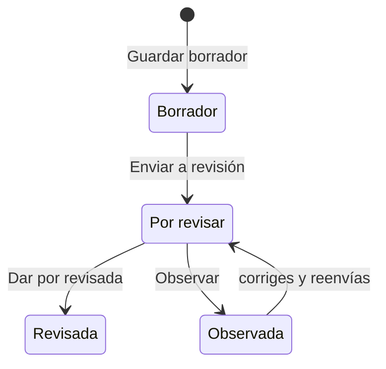

# Liquidación de Viáticos (ANEXO 5)

La liquidación de viáticos calcula, después del viaje, el viático que corresponde a cada persona
de ACEAA que viajó: cuántos días, a qué tarifa y con qué retención. Tiene **una hoja por persona
institucional** y, una vez revisada, sus montos entran a la rendición como gastos `LV`.

- **Quién la hace:** quien hizo la solicitud, sobre una solicitud de viaje propia ya
  desembolsada. Cada solicitud tiene una sola liquidación.
- **Quién la revisa:** el **Director de Programa** que eliges; se propone el de la solicitud.
- **Quién más la ve:** cada persona que tiene una hoja en la liquidación.

Los terceros no van en el ANEXO 5: sus viáticos se rinden con la planilla de terceros.

## Crear la liquidación

1. En el menú lateral, abre **Viajes y Viáticos** y elige **Liquidación de Viáticos**.
2. Pulsa **Nueva liquidación**.
3. En **¿Qué viaje liquidas?**, elige la solicitud. Solo aparecen tus solicitudes de viaje
   desembolsadas que aún no tienen liquidación. El sistema arma una hoja por cada persona de
   ACEAA del viaje, con los días de viático de la solicitud y las tarifas vigentes.
4. Revisa la cabecera: **Lugar de emisión**, **Fecha** y **Director de Programa que
   revisa**. El director viene propuesto desde la solicitud; puedes cambiarlo. No puedes
   elegirte a ti ni a Dirección Financiera.
5. En **Hojas por persona**, revisa cada hoja:
   - **Cargo**, **Nº C.I.** (se toma del perfil), **Sede**, **Vía** (aérea, terrestre) y
     **Destino**.
   - **Fecha de salida**, **Fecha de retorno** y **Motivo de viaje**.
   - La tabla de tarifas: por cada fila elige la **Tarifa** (con **Elegir tarifa**), el **%**
     (100% viático completo o 50% medio viático) y los **Días**. **Importe día** y **Total** se
     calculan solos. Usa **Agregar fila** o **Quitar fila** si hace falta.
   - Al pie de la hoja: **Total viático**, **Menos: retención del RC-IVA 13%** y **Total a
     pagar**.
6. Si viajó alguien más de ACEAA, pulsa **Agregar persona**. Para sacar a alguien, usa **Quitar
   persona**.
7. Revisa **Total a pagar de todas las hojas**.
8. Pulsa **Guardar borrador** para seguir después, o **Guardar y enviar a revisión** para
   mandarla al Director de Programa.

:::info Cómo se calcula
El total a pagar de cada fila es la tarifa del catálogo por los días y por el porcentaje (100% o
50%). Ese es el líquido que recibe la persona. El total viático (bruto) se obtiene dividiendo el
líquido entre 0,87, y la diferencia es la retención del RC-IVA 13%. El servidor recalcula
siempre al guardar.
:::

:::warning Si te pasas del presupuesto
Si lo liquidado supera lo presupuestado para viáticos en la solicitud, el total se marca y verás
el aviso. Puedes guardar igual: la diferencia queda a la vista del revisor.
:::

## Los estados de la liquidación

| Estado          | Qué significa para ti                                                         |
| --------------- | ----------------------------------------------------------------------------- |
| **Borrador**    | La estás preparando. Puedes editarla o eliminarla.                            |
| **Por revisar** | La enviaste; espera la revisión del Director de Programa. No puedes editarla. |
| **Observada**   | El Director de Programa te la devolvió con un motivo. Corrígela y reenvíala.  |
| **Revisada**    | Lista. Ya puedes importarla a la rendición. No se puede eliminar.             |

## Enviar a revisión

Si guardaste un borrador, ábrelo desde el listado y pulsa **Enviar a revisión**. Mientras
espera, el detalle muestra "La liquidación está esperando la revisión de" y el nombre del
director.

## Revisión del Director de Programa

Si te eligieron como revisor:

1. Te llega el aviso **Liquidación por revisar** en **Notificaciones**. También la encuentras
   en **Liquidación de Viáticos**, pestaña **Por revisar**.
2. Abre la liquidación. Puedes ver **Todas las hojas** o la de cada persona con su botón.
3. Decide:
   - **Dar por revisada**: la liquidación pasa a **Revisada** y se avisa al autor.
   - **Observar**: escribe el motivo (por ejemplo "El retorno fue a media tarde, corresponde
     medio viático") y confirma. La liquidación vuelve al autor.

## Corregir una liquidación observada

1. Abre la liquidación desde el aviso **Liquidación observada** o desde el listado.
2. Lee el recuadro **Liquidación observada por el Director de Programa**.
3. Pulsa **Editar**, corrige y guarda con **Guardar y enviar a revisión**.

## Llevarla a la rendición

Con la liquidación **Revisada**, en el paso 2 de la [rendición](./rendicion.md) pulsa
**Importar gastos LV**. Se agrega un gasto de tipo **Liquidación Viáticos** por cada persona y
partida, con su RC-IVA 13% ya calculado. Si ya los importaste, el bloque indica "ya importada".

## El documento impreso

En el detalle tienes **Descargar PDF** (todas las hojas) o, con una persona elegida,
**Descargar PDF de la persona**. Cada hoja es un ANEXO 5 completo:

- **Encabezado:** logo de ACEAA a la izquierda, logo de AMZ Desk a la derecha, "ANEXO 5", el
  título LIQUIDACIÓN DE VIÁTICOS (Expresado en Bolivianos) y el código.
- **Cabecera:** proyecto, actividad y **Lugar y Fecha** escritos como texto, por ejemplo "La
  Paz, 30 de octubre de 2026". El ANEXO 5 ya no imprime tipo de cambio.
- **Datos de la persona:** nombre, cargo, sede, vía, motivo, fechas de salida y retorno, días
  por escala y destino.
- **Liquidación en bolivianos:** cada fila con descripción, días, importe por día y total;
  total viático, la retención del RC-IVA 13%, el total a pagar y el monto en letras ("SON").
- **Firmas**, con nombre y cargo debajo de cada una:
  - **Revisado por**: Dirección Financiera.
  - **Aprobado por**: el Director Ejecutivo.
  - **Recuadro del beneficiario**: firma, nombre, cargo y Nº de C.I. de la persona de la hoja.

:::info Dos revisiones distintas
En el sistema la revisa el Director de Programa. En el papel, el ANEXO 5 lo firman Dirección
Financiera ("Revisado por") y el Director Ejecutivo ("Aprobado por"), además de cada
beneficiario.
:::

## Consejos

- Si el cargo o el C.I. de una persona salen vacíos, pide que se completen en su perfil; no los
  inventes en la hoja.
- Revisa los medios viáticos: el día de retorno a media tarde suele ser 50%.
- Envía la liquidación apenas vuelvas: la rendición no puede importar los viáticos hasta que
  esté revisada.
