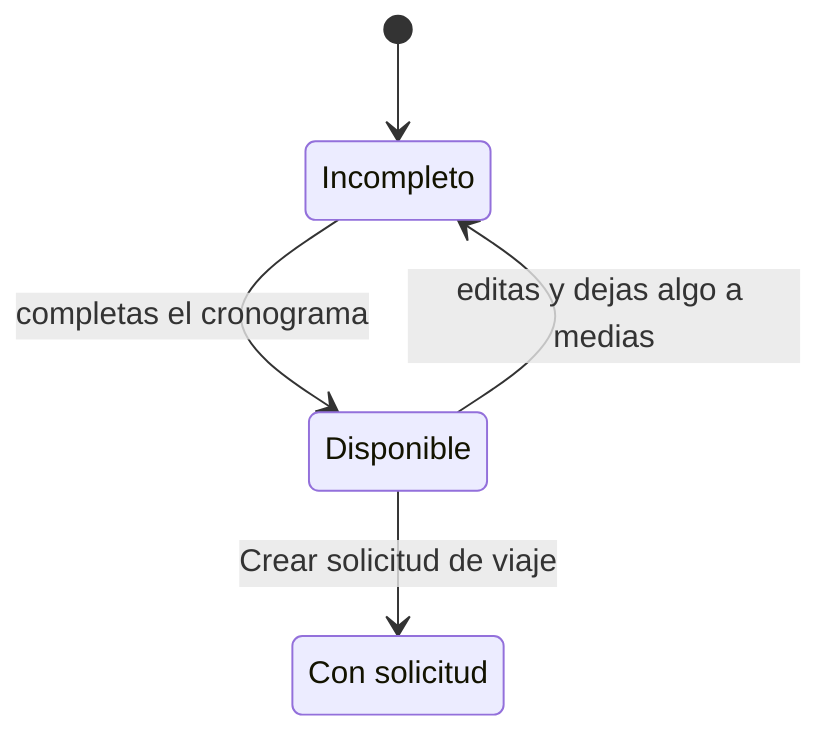

# Planificación de Viaje (ANEXO 1)

El plan de viaje es el primer paso de todo viaje: describe a dónde vas, para qué, qué
actividades harás cada día y quiénes te acompañan. **Toda solicitud de fondos para viaje nace
de un plan**, así que sin plan no hay solicitud.

- **Quién lo hace:** la persona responsable del viaje. Cualquier usuario puede crear planes.
- **Quién lo revisa:** nadie en el sistema. El plan no pasa por ningún flujo de aprobación: el
  VoBo lo firma en papel el **Director Ejecutivo**, sobre el ANEXO 1 impreso.

## Crear un plan

1. En el menú lateral, abre **Viajes y Viáticos** y elige **Planes de Viaje**.
2. Pulsa **Nuevo plan de viaje**.
3. Completa la cabecera:
   - **Nombre**: se toma de tu usuario y no se puede cambiar.
   - **Cargo**: se propone el de tu perfil; puedes corregirlo.
   - **Lugar(es) de viaje**: por ejemplo "Riberalta - Guayaramerín".
   - **Objetivo del viaje**.
4. En **Cronograma**, pulsa **+ Agregar actividad al cronograma** por cada actividad. En cada
   una indica:
   - **Fechas**: elige el rango en el calendario. **Días** se calcula y puedes ajustarlo en
     medios días (mínimo 0,5).
   - **Lugar de salida** y **Lugar de llegada**.
   - **Actividad programada**: qué harás.
   - **Personal ACEAA**: cuántas personas de ACEAA participan (al menos 1). Al escribir la
     cantidad se abre la ventana **Personal institucional**: busca por nombre o cargo, marca a
     cada persona y pulsa **Confirmar**. El botón **Personal institucional (x/y)** queda en rojo
     mientras falte gente por elegir.
   - **Terceros**: cuántas personas externas participan (hasta 50 por actividad). Sus nombres no
     se piden aquí: se registran después, en la solicitud.
5. Al pie, revisa **Lugar de emisión** (se propone la sede de tu perfil) y **Fecha**. El
   recuadro **VoBo — Director Ejecutivo** muestra quién firmará el VoBo; no se puede cambiar.
6. Pulsa **Guardar plan**.

:::tip Puedes guardar a medias
Un plan libre se puede guardar incompleto y terminarlo después. Solo necesitas que esté
completo para iniciar la solicitud.
:::

## La situación del plan

El plan no tiene estados de aprobación. En la columna **Estado** del listado verás su
situación, que el sistema deduce sola:

| Situación         | Qué significa                                                                                                                                | Qué puedes hacer                                                  |
| ----------------- | -------------------------------------------------------------------------------------------------------------------------------------------- | ----------------------------------------------------------------- |
| **Incompleto**    | Falta algo: una actividad sin lugar de salida o llegada, o una actividad donde las personas elegidas no coinciden con la cantidad declarada. | Editarlo. Al abrirlo, un aviso te dice exactamente qué falta.     |
| **Disponible**    | Está completo y todavía no respalda ninguna solicitud.                                                                                       | Editarlo, eliminarlo o **Crear solicitud de viaje**.              |
| **Con solicitud** | Ya respalda una solicitud de fondos. La columna **Solicitud** muestra su código.                                                             | Verlo e imprimirlo. Solo se edita si esa solicitud fue observada. |

## Reglas de edición

- Solo tú, como responsable, puedes editar o eliminar tu plan.
- Mientras el plan no respalde una solicitud, lo editas libremente desde **Editar**.
- Cuando ya respalda una solicitud, queda bloqueado. **La única excepción**: si esa solicitud
  fue observada, puedes corregir el plan. Al abrirlo verás el aviso "Este plan respalda la
  solicitud ..., que fue observada". Guarda con **Guardar cambios** y luego vuelve a la
  solicitud para reenviarla: sus viáticos y la nómina de terceros se validan contra el plan
  corregido.
- Un plan que respalda una solicitud no se puede eliminar. La opción **Eliminar** del menú de
  acciones solo aparece en los planes sin solicitud.
- Cada plan respalda **una sola** solicitud. Para otro viaje, crea otro plan.

## Desde el plan a la solicitud

Cuando el plan está **Disponible**, tienes dos caminos para iniciar la solicitud:

- En el detalle del plan, pulsa **Crear solicitud de viaje**.
- En el listado, abre el menú de acciones del plan y elige **Crear solicitud de viaje**.

El plan queda preseleccionado en el primer paso de la solicitud. Sigue en
[Solicitud de Fondos](./solicitud.md).

## El documento impreso

Al abrir un plan ves el ANEXO 1 tal como se imprime. Pulsa **Descargar PDF** para obtenerlo.

- **Encabezado:** logo de ACEAA a la izquierda, logo de AMZ Desk a la derecha, "ANEXO 1" y el
  título PLANIFICACIÓN DE VIAJE.
- **Cabecera:** nombre, cargo, lugar(es) de viaje y objetivo del viaje.
- **Cronograma:** fechas, lugar de salida y llegada, actividad programada y participantes (de
  ACEAA, con sus nombres, y terceros).
- **Notas al pie:** para la rendición se adjunta el Registro de Asistencia de la actividad, si
  corresponde.
- **Lugar y fecha de emisión.**
- **Firmas**, con nombre y cargo debajo de cada una:
  - **Responsable de viaje**: tú.
  - **VoBo. Director Ejecutivo**: el Director Ejecutivo, con el cargo DIRECTOR EJECUTIVO.

:::info El VoBo es en papel
Imprime el ANEXO 1, fírmalo y hazlo firmar por el Director Ejecutivo según el procedimiento de
ACEAA. El sistema no espera esa firma para dejarte pedir los fondos.
:::

## Consejos

- Declara en **Personal ACEAA** solo a quienes viajan de verdad: esas personas tendrán después
  su propia hoja en la [Liquidación de Viáticos](./liquidacion-viaticos.md).
- Si el viaje cambia antes de pedir los fondos, edita el plan en lugar de crear otro.
- Si un plan aparece **Incompleto** y no ves por qué, ábrelo: el aviso arriba del ANEXO 1 dice
  qué actividad no cuadra.
