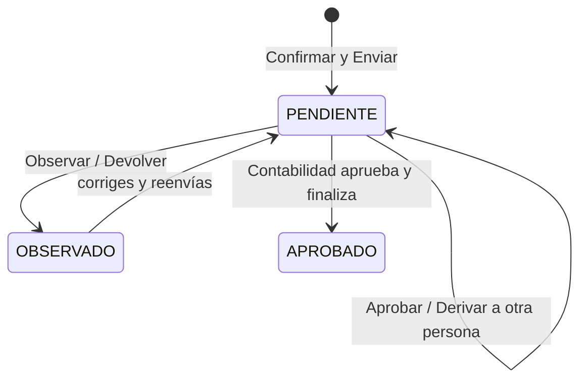

# Rendición (ANEXO 4)

La rendición justifica en qué se gastaron los fondos desembolsados: cada gasto con su
comprobante, sus retenciones impositivas y su partida. Cuando Contabilidad la aprueba, la
solicitud pasa a **EJECUTADO** y el gasto real se registra en el POA.

- **Quién la hace:** quien hizo la solicitud, una vez desembolsada. Cada solicitud tiene una
  sola rendición.
- **Quién la revisa:** la persona que eliges al enviarla. Puede aprobar y derivar a otra
  persona, pero **solo Contabilidad la cierra** de forma definitiva.

:::tip Antes de empezar
Ten revisada la [Liquidación de Viáticos](./liquidacion-viaticos.md): sus viáticos entran a la
rendición con un clic. Ten también listo el [Informe de Viaje](./informe-viaje.md); la
rendición avisa si falta.
:::

## Crear la rendición

El asistente tiene dos pasos: **1. Selección de Solicitud** y **2. Rendición de Gastos**.

Entra de una de estas formas:

- En **Mis Solicitudes**, columna **Rendición**, pulsa **Crear** en la solicitud desembolsada.
- En **Mis Rendiciones**, pulsa **Nueva Rendición**.
- Desde el aviso de desembolso en **Notificaciones**.

### Paso 1: Selección de Solicitud

1. En **Vincular a una Solicitud Desembolsada**, busca por código o motivo y elige la
   solicitud. Solo aparecen tus solicitudes en estado **DESEMBOLSADO** sin rendición.
2. Revisa la tarjeta: motivo, destino, período, **Monto Total Anticipado** y **Director de
   Programa**.
3. Si falta el informe de viaje verás el aviso "Falta el informe de viaje (ANEXO 7)" con el
   botón **Crear informe de viaje**. Puedes seguir igual.
4. Pulsa **Siguiente**.

### Paso 2: Rendición de Gastos

1. **Liquidación de Viáticos.** Si tu liquidación ya está **Revisada**, pulsa **Importar gastos
   LV**: se agrega un gasto LV por cada persona y partida. Si todavía no está revisada, verás
   "Se podrá importar cuando el Director de Programa la revise". Si no existe, el aviso ofrece
   **Crear liquidación**.
2. **Enlace de Comprobantes.** Pega la dirección (Google Drive u otra) de la carpeta con todos
   los comprobantes escaneados de esta rendición.
3. **Gastos.** Pulsa **Agregar fila** por cada comprobante y completa:
   - **Fecha**, **N° Doc.** y **Tipo Doc.**
   - **Partida Presupuestaria**: una de las partidas de la solicitud.
   - **Descripción** del gasto.
   - **MONTO BS**: escribe en **MONTO LÍQUIDO** lo que pagaste. **TOTAL C/ IMP** se calcula
     solo.
   - **TIPO RET.**: solo se pide con **Recibo** o **Boleta** en partidas generales. Elige
     **Bien**, **Servicio** o **Alquiler**.
4. **Observaciones Generales (Opcional).**
5. Revisa el **Resumen General de Gastos** y el pie: **Monto Anticipado**, **Presupuestado**,
   **Total Rendido** y **Saldo a Devolver**.
6. Pulsa **Finalizar y Firmar**.

### Revisar y enviar

En la ventana **Revisar y Enviar Rendición** verás la solicitud vinculada, el resumen
financiero (anticipo y ejecutado) y la lista de gastos.

1. En **Derivar Revisión A:**, busca y elige a quien revisará tu rendición.
2. Pulsa **Confirmar y Enviar**. Si algo falta, usa **Volver a editar**.

La rendición queda en **PENDIENTE** y esa persona recibe el aviso **Rendición pendiente**.

:::caution Pendiente de confirmar
La pantalla pide elegir "a tu inmediato superior o al responsable del área que verificará
físicamente tu descargo", y no propone al Director de Programa de la solicitud. Confirma con
Administración a quién se envía la rendición de un viaje: al Director de Programa o
directamente a Contabilidad.
:::

## Tipos de documento y retenciones

La retención no es un porcentaje fijo: depende del tipo de documento y de la partida. El sistema
la calcula en la misma fila.

| Tipo Doc.                                                                                         | Retención                                |
| ------------------------------------------------------------------------------------------------- | ---------------------------------------- |
| **Factura**                                                                                       | Ninguna                                  |
| **Declaración Jurada** y **Planilla Pasajes Terceros**                                            | Ninguna                                  |
| **Liquidación Viáticos** (LV), **Planilla Viáticos Terceros** y **Recibo** en partida de viáticos | RC-IVA 13%                               |
| **Planilla Alimentación Terceros**                                                                | RC-IVA 13% + IT 3%                       |
| **Recibo** en partida de hospedaje                                                                | IVA 13% + IT 3%                          |
| **Recibo** o **Boleta** de un bien                                                                | IUE 5% + IT 3%                           |
| **Recibo** o **Boleta** de un servicio o alquiler                                                 | RC-IVA 13% (IVA 13% en alquiler) + IT 3% |

El monto con retenciones es el que se carga al presupuesto: tú recibiste el líquido y la
institución paga los impuestos retenidos.

## Los estados de la rendición

| Estado        | Qué significa para ti                                     |
| ------------- | --------------------------------------------------------- |
| **PENDIENTE** | Está en revisión. No puedes editarla.                     |
| **OBSERVADO** | Te la devolvieron con un motivo. Corrígela y reenvíala.   |
| **APROBADO**  | Contabilidad la cerró. La solicitud pasa a **EJECUTADO**. |

En **Mis Rendiciones** ves el estado, el **Aprobador Actual** y el **Monto Total** de cada una.

## La revisión

Quien recibe la rendición la abre desde el aviso en **Notificaciones**. Ve los comprobantes
adjuntos (**Ver comprobantes**), el aviso del informe de viaje, el resumen por partida contable
y por partida presupuestaria, y las observaciones.

- **Aprobar / Derivar**: aprueba su parte y deriva la rendición a la siguiente persona o a
  Contabilidad, eligiéndola en **Seleccionar siguiente aprobador / contador...**.
- **Aprobar y Finalizar Rendición**: solo lo ve Contabilidad. Cierra la rendición de forma
  definitiva y ejecuta el gasto en el POA.
- **Observar / Devolver**: abre **Observar Rendición**; el motivo se registra y la rendición
  vuelve a quien la hizo.

:::info El POA es el límite también aquí
Si al aprobar el gasto real superara el costo total de la partida, el sistema no deja cerrar la
rendición. Lo no gastado de la solicitud vuelve a quedar disponible en el POA.
:::

## Corregir una rendición observada

1. En **Notificaciones**, pulsa el aviso **Rendición observada**: te lleva directo a la
   corrección.
2. Arriba verás **Observación del revisor** con el motivo.
3. Corrige los gastos señalados.
4. Pulsa **Finalizar y Firmar**, elige de nuevo a quien revisará y pulsa **Confirmar y
   Enviar**.

Solo se puede editar una rendición en **OBSERVADO**.

## El documento impreso: PDF y Excel

Desde **Mis Rendiciones**, en el menú de acciones de cada una, tienes **Ver Detalle**,
**Descargar PDF** y **Descargar Excel**. El Excel trae el mismo ANEXO 4 con fórmulas para los
saldos y totales.

- **Encabezado:** logo de ACEAA a la izquierda, logo de AMZ Desk a la derecha, "ANEXO 4" y el
  título RENDICIÓN DE FONDOS EN AVANCE (Expresado en Bolivianos).
- **Cabecera:** proyecto, código de actividad, cheque a nombre de, banco y cuenta, fecha de
  entrega de fondos y fecha de rendición.
- **Detalle:** cada gasto con fecha, número y tipo de documento, partida, descripción, monto,
  retenciones (RC-IVA, IUE, IT, total impuestos) y neto, con ingresos, egresos y saldo.
- **Resumen contable** por partida y el saldo a favor del empleado o del proyecto.
- **Firmas**, con nombre y cargo debajo de cada una:
  - **Elaborado por**: tú.
  - **Revisado por**: Dirección Financiera.
  - **Aprobado por**: el Director Ejecutivo.

## Consejos

- Importa primero los gastos LV y luego agrega el resto: así no duplicas viáticos.
- Ningún comprobante es obligatorio para enviar, pero quien revisa puede observar la rendición
  si faltan. Revisa que el enlace de comprobantes tenga permisos de lectura.
- Si el **Saldo a Devolver** es positivo, deposita ese monto según te indique Dirección
  Financiera; el sistema solo lo calcula.

:::caution Pendiente de confirmar
El plazo para rendir no lo controla el sistema. El instructivo de ACEAA habla de 10 o 15 días
después de concluida la actividad; confirma el plazo vigente con Administración.
:::
