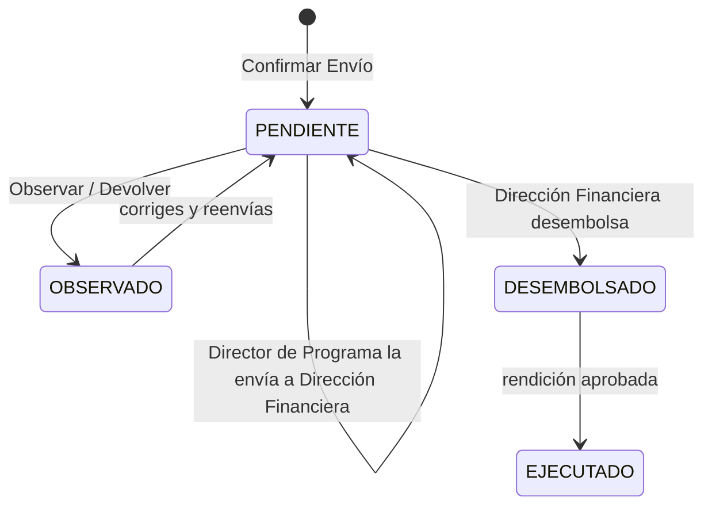

# Solicitud de Fondos para viaje (ANEXO 2)

La solicitud de fondos pide el dinero del viaje: viáticos, hospedajes y otros gastos, cargados
contra las partidas del POA. Nace de un [plan de viaje](./planificacion.md) completo y recorre
dos revisiones antes del desembolso.

- **Quién la hace:** la persona responsable del viaje, sobre un plan propio y **Disponible**.
- **Quién la revisa:** primero el **Director de Programa** que eliges al enviarla; después
  **Dirección Financiera**, que la desembolsa.

## Crear la solicitud

La solicitud se llena en un asistente de tres o cuatro pasos. La barra superior muestra en qué
paso estás: **1. Plan de Viaje**, **2. Solicitud**, **3. Respaldos** y, si el plan tiene
terceros, **4. Nómina**. Usa **Siguiente** y **Atrás** para moverte.

Para empezar, entra a **Mis Solicitudes** y pulsa **Nueva Solicitud**, o usa **Crear solicitud
de viaje** desde el plan.

### Paso 1: Plan de Viaje

1. En **Elige el plan de viaje**, marca el plan del que nace la solicitud. Solo aparecen tus
   planes completos y sin solicitud.
2. Revisa el resumen del **Plan elegido** y pulsa **Siguiente**.

Si ves "No tienes planes de viaje disponibles", primero crea o completa un plan con
**Nuevo plan de viaje**.

La solicitud toma del plan los lugares, el objetivo, las fechas y las actividades.

### Paso 2: Detalle Económico

Aquí eliges de qué presupuesto salen los fondos y cargas cada monto.

**Presupuesto (POA)**

1. En **Código POA**, busca y elige el código.
2. En **Proyecto**, elige el proyecto.
3. En **Partida Presupuestaria**, pulsa **Agregar Partida**. En la tarjeta elige **Grupo**,
   **Partida** y luego **Seleccionar Ítem / Actividad de Presupuesto**. La tarjeta muestra el
   **Límite POA** y el **Saldo Disponible**.
4. Repite para cada partida que vayas a usar.

:::warning El saldo del POA es un límite
No puedes pedir más de lo que queda disponible en la partida. Una partida marcada **Sin
Fondos** no tiene saldo, y **Saldo Comprometido** indica que otras solicitudes en curso ya
reservaron parte de él. Si cambias el **Código POA** o el **Proyecto**, el sistema te
pide confirmar con **Sí, Limpiar y Cambiar**, porque borra lo cargado.
:::

**Viáticos** (sección **Detalle de Viáticos**)

1. Pulsa **Agregar Viático**.
2. Elige la **Partida Presupuestaria**: solo aparecen partidas de viáticos.
3. Elige el **Concepto Viático** (la escala del destino) y el **Tipo**: **Institucional** para
   personal de ACEAA o **Tercero** para personas externas.
4. En **Planificaciones**, marca las actividades del plan que cubre este viático. **Días** y
   **Personas** se toman de ellas.
5. **Costo Unitario (Bs)** se llena solo con la tarifa del catálogo. Solo en los destinos al
   exterior la escribes tú.
6. Revisa **TOTAL LÍQUIDO (A Recibir)**, **TOTAL PRESUPUESTADO** y la retención **RC-IVA 13%**.

:::tip Un viático por grupo de personas
Si las actividades elegidas tienen distinta cantidad de personas, el sistema te pide crear un
viático separado para cada actividad.
:::

**Hospedajes** (sección **Hospedajes**)

1. Pulsa **Agregar Hospedaje**.
2. Elige la **Partida (Línea POA)**, la **Región** y el **Destino**.
3. En **Personal**, elige **Institucional** o **Socio**: cada uno tiene su rango de tarifa.
4. Elige el **Tipo Documento** (**Recibo** o **Factura**), el **Nº Personas** y el **Nº Noches**.
5. Ajusta la **Tarifa Unitaria (Bs.)** con el control deslizante, dentro del rango mínimo y
   máximo de la región. En **Otras localidades** e **Internacional** la tarifa se escribe a mano.

| Región                                                                          | Institucional (Bs por noche) | Socio (Bs por noche) |
| ------------------------------------------------------------------------------- | ---------------------------- | -------------------- |
| Eje troncal (La Paz, Santa Cruz, Cochabamba)                                    | 250 a 750                    | 250 a 350            |
| Bolivia Sur (Sucre, Potosí, Oruro, Tarija)                                      | 200 a 500                    | 200 a 250            |
| Bolivia Norte (Trinidad, Cobija)                                                | 180 a 350                    | 180 a 230            |
| Ciudades Intermedias (Rurrenabaque, San Buenaventura, Coroico, Apolo, Caranavi) | 140 a 350                    | 140 a 200            |
| Otras localidades, Internacional                                                | Según oferta                 | Según oferta         |

Una tarifa en el rango superior requiere justificación y autorización de Dirección Ejecutiva.
Con **Recibo**, el hospedaje suma IVA 13% e IT 3% al presupuesto.

**Otros gastos** (sección **Detalle de Gastos**)

1. Pulsa **Agregar Gasto** para pasajes, combustible u otros gastos.
2. Elige la **Partida Presupuestaria**, el **Documento** (**Factura** o **Recibo**), el **Tipo**,
   la **Cantidad** y el **Costo Unitario (Bs)**.
3. Con **Recibo**, el sistema suma las retenciones que correspondan (RC-IVA 13%, IT 3% o IUE 5%).
   Con **Factura** no hay retención.

**Información Complementaria**

- Escribe el **Motivo de la Solicitud**. Es obligatorio.

Al pie siempre ves dos totales: **TOTAL LÍQUIDO (A Recibir)**, lo que recibes en mano, y
**TOTAL PRESUPUESTADO (Incl. Impuestos)**, lo que se descuenta del POA.

Al pulsar **Siguiente**, el sistema comprueba que cada viático, gasto y hospedaje tenga su
partida, que ninguna partida quede excedida y que cada partida elegida tenga algún monto.

### Paso 3: Documentos de Respaldo

Adjunta enlaces (Google Drive u otro) a lo que respalda los precios:

- **Cuadro Comparativo** (opcional): pega el enlace o vincula uno del sistema.
- **Cotizaciones**: pega uno o varios enlaces con **Añadir otra cotización**.

Ambos son opcionales. Pulsa **Siguiente**, o **Revisar y Enviar** si el plan no tiene terceros.

### Paso 4: Nómina de Terceros

Solo aparece si el plan declara terceros. Por cada actividad:

1. Pulsa **Agregar Persona** tantas veces como terceros declaraste.
2. Escribe el **Nombre Completo** y la **Procedencia / Institución** de cada uno.

La cantidad registrada debe coincidir con la del plan. Pulsa **Revisar y Enviar**.

### Revisar y enviar

Se abre la ventana **Revisar y Enviar Solicitud** con la planificación, la información bancaria
del proyecto y el presupuesto por partida.

1. En **Director de Programa**, busca y elige a quien revisará tu solicitud. En el ANEXO 2
   firma como "Revisado por" la Dirección Financiera. No puedes elegirte a ti ni a Dirección Financiera.
2. Revisa los totales y pulsa **Confirmar Envío**. Si algo está mal, usa **Volver a editar**.

La solicitud queda en estado **PENDIENTE** y el Director de Programa recibe el aviso.

## Los estados de la solicitud

| Estado           | Qué significa para ti                                                                                                        |
| ---------------- | ---------------------------------------------------------------------------------------------------------------------------- |
| **PENDIENTE**    | Está en revisión, del Director de Programa o de Dirección Financiera. No puedes editarla. El presupuesto ya queda reservado. |
| **OBSERVADO**    | Un revisor te la devolvió con un motivo. Corrígela y reenvíala.                                                              |
| **DESEMBOLSADO** | Dirección Financiera liberó los fondos. Ya puedes viajar y, al volver, rendir.                                               |
| **EJECUTADO**    | Contabilidad aprobó tu rendición. El viaje está cerrado.                                                                     |

En **Mis Solicitudes** ves el estado, el **Director de Programa**, el **Cód. Desembolso** y,
en la columna **Rendición**, el botón para crearla o verla.

## Revisión del Director de Programa

Si te eligieron como Director de Programa:

1. Abre **Notificaciones**. La solicitud llega como aviso **Asignada**; púlsalo.
2. Revisa el ANEXO 2 en pantalla, el cronograma del plan (**Ver ANEXO 1**), los documentos de
   respaldo, el desglose por partida y la nómina de externos.
3. Decide:
   - **Enviar a Dirección Financiera**: confirmas que la solicitud está bien estructurada. En
     la ventana, pulsa **Confirmar envío**. La solicitud sigue en **PENDIENTE**, ahora en la
     bandeja de Dirección Financiera.
   - **Observar / Devolver**: escribe el motivo y pulsa **Enviar Observación**. La solicitud
     vuelve a quien la hizo, en **OBSERVADO**.

## Revisión de Dirección Financiera

Dirección Financiera recibe el aviso **Derivada** ("fue revisada por el Director de Programa y
requiere tu aprobación"). En la misma pantalla de revisión puede:

- **Desembolsar**: ver [Desembolso](./desembolso.md).
- **Observar / Devolver**: la solicitud vuelve a quien la hizo, en **OBSERVADO**.

En Dirección Financiera la solicitud ya no se deriva a otra persona: se desembolsa o se observa.

## Corregir una solicitud observada

1. Te llega el aviso **Observada** en **Notificaciones**. También ves el estado **OBSERVADO** en
   **Mis Solicitudes**, con el botón **Corregir**.
2. Pulsa **Corregir**. Arriba del asistente verás el recuadro **Solicitud observada** con el
   motivo.
3. Corrige lo señalado en los pasos que correspondan.
   - Si lo observado está en el plan (fechas, actividades, personas), en el paso 1 pulsa
     **Corregir plan**, guarda el plan y vuelve a la solicitud.
   - El Director de Programa queda fijo: es el que elegiste al crearla.
4. Termina con **Revisar y Enviar** y **Confirmar Envío**.

La solicitud vuelve a **PENDIENTE** y regresa al Director de Programa, aunque la haya observado
Dirección Financiera: el circuito empieza de nuevo.

## El documento impreso

El ANEXO 2 se ve en pantalla al abrir la solicitud y se descarga con **Descargar**.

- **Encabezado:** logo de ACEAA a la izquierda, logo de AMZ Desk a la derecha, "ANEXO 2" y el
  título SOLICITUD DE FONDOS PARA VIAJES.
- **Cabecera:** A (Director Ejecutivo), DE (el Director de Programa), proyecto, actividad,
  cheque a nombre de, lugar y motivo del viaje, fechas de salida y llegada, fecha de solicitud.
- **Viáticos** del personal institucional y de terceros: concepto, días, personas, tarifa por
  día, total bruto, RC-IVA 13% e importe neto, con subtotales.
- **Otros gastos**, **TOTAL GENERAL**, observaciones y banco.
- **Firmas**, con nombre y cargo debajo de cada una:
  - **Solicitado por**: tú.
  - **Revisado por**: Dirección Financiera.
  - **Aprobado por**: el Director Ejecutivo.
- **Nombre de los viajeros**: cada persona del viaje con su cargo (los terceros sin cargo), y
  espacio para su firma y el importe recibido.

## Consejos

- Elige al Director de Programa que de verdad responde por el proyecto: el sistema no lo
  impide, pero la firma queda en el documento.
- Si no aparecen partidas de viáticos al cargar un viático, falta agregar en el presupuesto una
  partida de viáticos.
- El sistema no exige anticipación, pero el manual de ACEAA pide presentar la solicitud con 48
  horas de anticipación.
