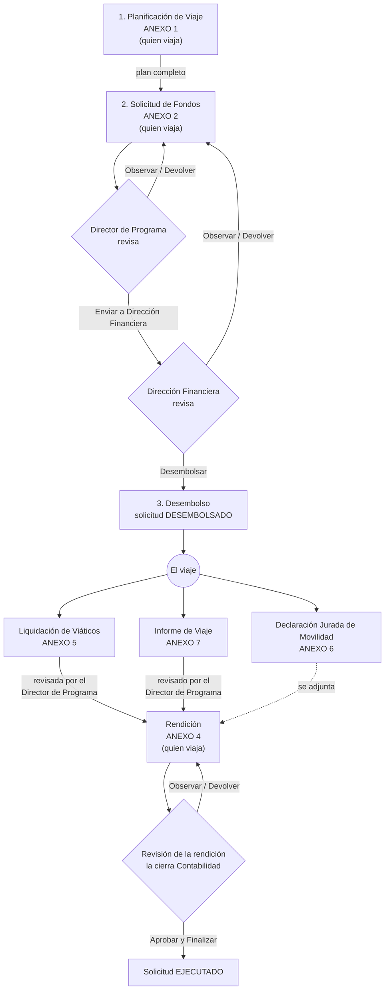

# Visión del flujo

Un viaje en AMZ Desk recorre una cadena de documentos, uno por cada anexo del Manual de
Procedimientos Administrativos. Esta página muestra la cadena completa, quién actúa en cada
paso y dónde está cada pantalla. Las páginas siguientes explican cada paso en detalle.

## La cadena completa

## Quién hace qué

| Paso | Documento                                                               | Lo hace              | Lo revisa en el sistema                          | Firmas impresas                                                                                 |
| ---- | ----------------------------------------------------------------------- | -------------------- | ------------------------------------------------ | ----------------------------------------------------------------------------------------------- |
| 1    | [Planificación de Viaje](./planificacion.md) (ANEXO 1)                  | Quien viaja          | Nadie: no tiene flujo de aprobación              | Responsable de viaje · VoBo. Director Ejecutivo                                                 |
| 2    | [Solicitud de Fondos](./solicitud.md) (ANEXO 2)                         | Quien viaja          | Director de Programa, luego Dirección Financiera | Solicitado por · Revisado por (Director de Programa) · Aprobado por (Director Ejecutivo)        |
| 3    | [Desembolso](./desembolso.md)                                           | Dirección Financiera | —                                                | —                                                                                               |
| 4    | [Rendición](./rendicion.md) (ANEXO 4)                                   | Quien viaja          | Quien elijas al enviar; la cierra Contabilidad   | Elaborado por · Revisado por (Dirección Financiera) · Aprobado por (Director Ejecutivo)         |
| 5    | [Liquidación de Viáticos](./liquidacion-viaticos.md) (ANEXO 5)          | Quien viaja          | Director de Programa                             | Revisado por (Dirección Financiera) · Aprobado por (Director Ejecutivo) · firma de cada persona |
| 6    | [Declaración Jurada de Movilidad](./declaracion-movilidad.md) (ANEXO 6) | Quien viaja          | Nadie: se firma en papel                         | Preparado por · Revisado por (Dirección Financiera) · Aprobado por (Director Ejecutivo)         |
| 7    | [Informe de Viaje](./informe-viaje.md) (ANEXO 7)                        | Quien viaja          | Director de Programa                             | Preparado por · Revisado por (Director de Programa) · Aprobado por (Director Ejecutivo)         |

:::info El Director Ejecutivo no aprueba en el sistema
El Director Ejecutivo aparece impreso como firmante en los anexos, pero no tiene ninguna acción
en AMZ Desk: firma en papel. El circuito digital lo recorren el Director de Programa, Dirección
Financiera y Contabilidad.
:::

## El orden después del viaje

La rendición es el último documento, pero se apoya en los otros tres. El orden recomendado es:

1. **Informe de Viaje** (ANEXO 7) y **Liquidación de Viáticos** (ANEXO 5): créalos y envíalos a
   revisión del Director de Programa apenas vuelvas.
2. **Declaración Jurada de Movilidad** (ANEXO 6), si tuviste traslados sin factura.
3. **Rendición** (ANEXO 4): con la liquidación ya revisada, sus viáticos entran solos como gastos
   `LV`.

La rendición avisa si falta el informe o la liquidación, pero no impide enviarla.

## Dónde está cada cosa

Todo vive en el menú lateral, dentro de **Viajes y Viáticos**:

| Opción del menú              | Para qué                                                                    |
| ---------------------------- | --------------------------------------------------------------------------- |
| **Planes de Viaje**          | Crear y ver tus ANEXO 1                                                     |
| **Mis Solicitudes**          | Crear, seguir y corregir tus solicitudes de fondos                          |
| **Mis Rendiciones**          | Crear y seguir tus rendiciones                                              |
| **Informe de Viaje**         | Tus informes y, en la pestaña **Por revisar**, los que te toca revisar      |
| **Liquidación de Viáticos**  | Tus liquidaciones y, en la pestaña **Por revisar**, las que te toca revisar |
| **Declaración de Movilidad** | Tus declaraciones de movilidad                                              |

Las solicitudes y rendiciones que te toca revisar llegan a **Notificaciones** (la Bandeja de
Entrada). Cada aviso abre directamente la pantalla donde actúas.

## Observar no es rechazar

Cuando un revisor **observa** un documento, lo devuelve a quien lo hizo con un motivo escrito.
El documento no se pierde: lo corriges y lo vuelves a enviar, y retoma el flujo. Verás el motivo
en un recuadro al abrir el documento y te llegará un aviso en **Notificaciones**.
